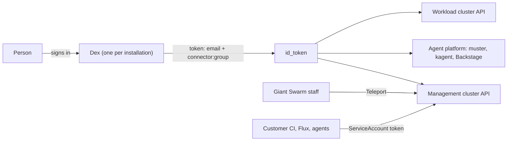
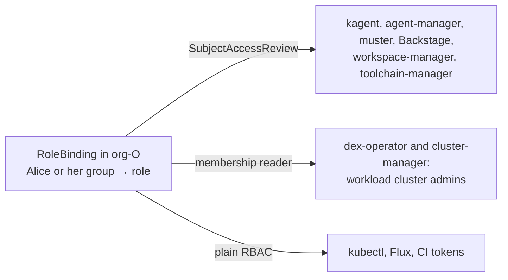
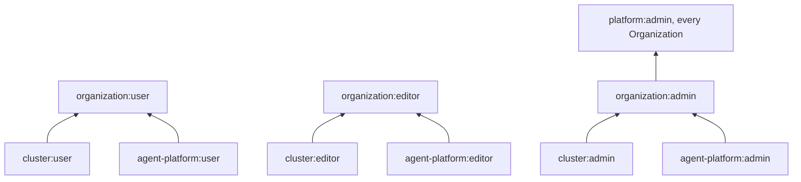
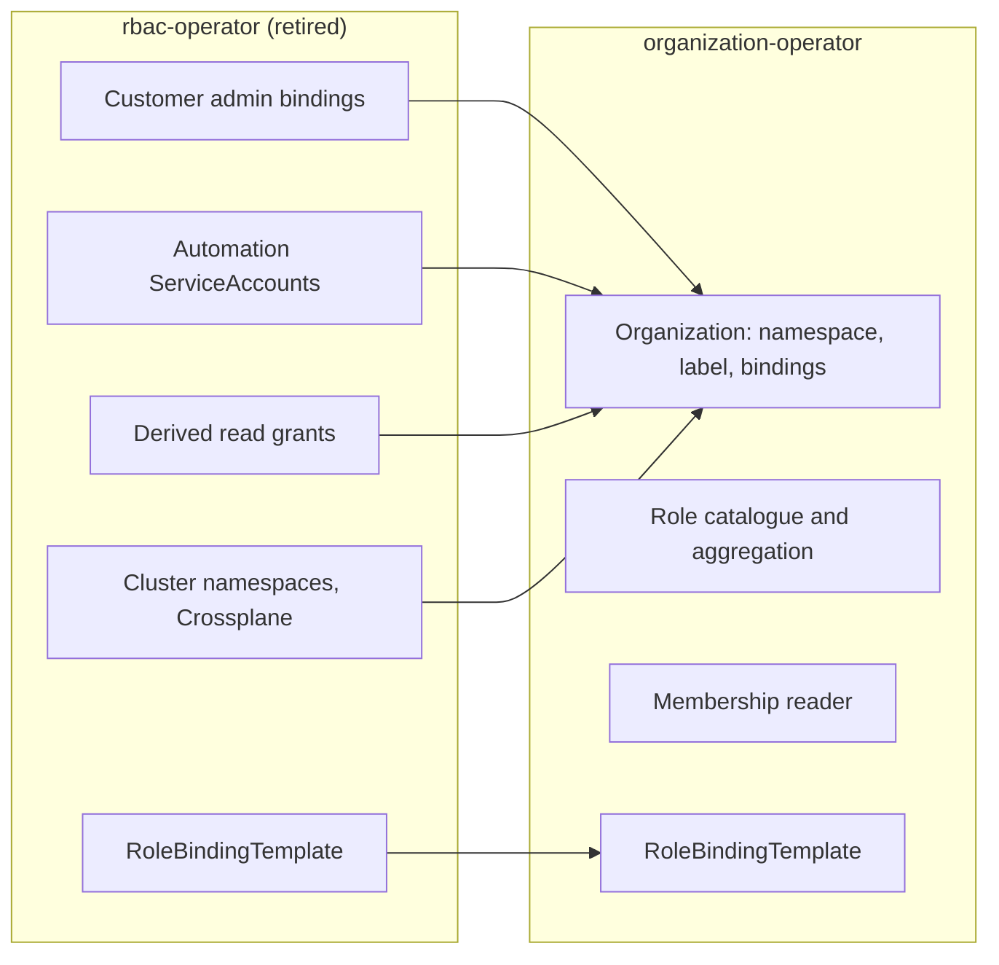
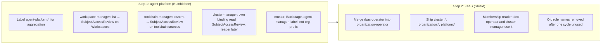

# Organization roles: one membership source, one operator

## TL;DR

- Today, "who belongs to an Organization" is answered differently by every product. Group lists live in nine places. A customer cannot make someone admin of one Organization without making them admin of all of them.
- We propose one rule: a person has a role in an Organization when a RoleBinding in that Organization's namespace says so. Nothing else holds a list of people.
- Roles get one naming scheme, `<capability>:<level>`, for example `cluster:admin` or `agent-platform:user`. Each platform ships its own roles; the operator combines them into `organization:user`, `organization:editor`, `organization:admin` and `platform:admin`.
- Checks happen in two ways only: ask the API server (`SubjectAccessReview`), or, where a system cannot ask (workload clusters), read the bindings through one reader package in the operator.
- We do it in two steps. Step 1 is the agent platform alone: the workspace, cluster and toolchain managers drop their own lists and use the `agent-platform:*` roles. Step 2 merges rbac-operator into organization-operator and adds the KaaS roles.
- Customers lose nothing. Their admin group, their automation ServiceAccounts and their existing bindings keep working. New roles arrive next to the old ones, and old names are removed only after nobody uses them.
- Observability joins later, through its own RFC by Atlas.
- Four questions need an answer before approval (see [Still to decide](#still-to-decide)).

## The problem, in plain words

A customer has two teams, Payments and Search, each with its own Organization. They want Alice to be admin of Payments and nothing else. Today they cannot do that cleanly:

- The customer's admin group is set in installation values. rbac-operator binds it to `cluster-admin` on the whole management cluster and in every Organization namespace. Alice is either admin everywhere or not admin.
- If the customer writes a RoleBinding for Alice in `org-payments`, three different programs read it and draw their own conclusions: rbac-operator (read access to releases and catalogs), dex-operator (admin on the workload clusters), cluster-manager (admin on new clusters). dex-operator reads it wrong: it treats a read-only binding as an admin binding.
- The agent platform has its own roles, `agent-platform:user`, `editor` and `admin`, bound by hand. Its managers do not use them: workspace-manager keeps a list of groups and emails, toolchain-manager keeps a list of owners, cluster-manager reads the KaaS `cluster-admin` bindings itself.
- What "an Organization namespace" is depends on the program: some look for the label `giantswarm.io/organization`, some for the `org-` name prefix, one accepts any string.
- Even the group name is spelled differently: Dex prefixes it with the connector name, some workload clusters add `oidc:`, and kagent adds its own prefix.

So a new product has no pattern to follow, each product invents its own, and the customer has to learn all of them.

## How it works today

Every installation has one Dex. A person signs in through a connector (`giantswarm-github`, `giantswarm-ad`, or the customer's own). The token names the person by email and lists their groups as `<connector>:<group>`, for example `customer:platform-admins`. That token is what the management cluster, muster, kagent, Backstage and the workload clusters see.

Three paths bypass Dex: Teleport for Giant Swarm staff (`system:masters` everywhere), client certificates for workload clusters, and ServiceAccount tokens (customer CI, Flux, machine callers).

Who decides what that person may do:

| Question | Answered by | Where the list lives |
|---|---|---|
| Is this person a customer admin? | rbac-operator | Installation values (`write_all` groups) |
| May they read this Organization? | rbac-operator, from any RoleBinding in the namespace | The RoleBinding |
| Are they admin on the Organization's workload clusters? | dex-operator and cluster-manager, from `cluster-admin` RoleBindings | The RoleBinding, plus the `write_all` groups |
| May they run this agent? | kagent, by asking the API server | The RoleBinding |
| May they write MCP servers? | muster, with the person's own token | A RoleBinding in muster's namespace |
| May they use this Workspace? | workspace-manager | Its own list of groups, emails and domains |
| May they add a toolchain? | toolchain-manager | Its own list |
| Who sees the platform's agents? | The agent-platform chart | `system:authenticated` |

The full inventory, with sources, is in [Appendix A](#appendix-a-everything-that-grants-access-today).

## What we propose

### One rule for membership

"Alice has role R in Organization O" means: there is a RoleBinding in `org-O` that binds Alice, or one of her groups, to R. That is the only place membership is written.

Every program that needs an answer gets it in one of two ways:

1. **Ask the API server.** A `SubjectAccessReview` asks "may this user do this verb on this resource in this namespace". kagent, agent-manager, muster and Backstage already work this way. workspace-manager and toolchain-manager will.
2. **Read the bindings through the operator.** A workload cluster cannot ask the management cluster at request time; its admin list has to be written into it. One package in the operator, the membership reader, answers "who holds role R in Organization O". It replaces the three programs that each read the bindings today, and it reads them correctly.

Runtime grants stay what they are and are not membership: sharing a session, granting a Slack thread, allowing a channel.

### One naming scheme for roles

Roles are ClusterRoles named `<capability>:<level>`, bound per Organization namespace. Each platform owns its capability.

| Role | What it allows | Owner |
|---|---|---|
| `agent-platform:user` / `editor` / `admin` | Run agents; write agents, workspaces, toolchains and MCP servers; manage models, keys and credentials | Bumblebee |
| `agent-platform:agent` | What a running agent may do about itself. New; see [Still to decide](#still-to-decide) | Bumblebee |
| `cluster:user` / `editor` / `admin` | See the Organization's clusters and apps; create and upgrade clusters and install apps; full admin on the Organization's workload clusters | Shield (apps: Honeybadger) |
| `organization:user` / `editor` / `admin` | Everything the capability roles allow at that level, combined | Shield |
| `platform:admin` | `organization:admin` in every Organization, plus creating Organizations | Shield |
| `platform:auditor` | Read everything except Secrets and ConfigMaps | Shield |

The `organization:*` and `platform:*` roles are Kubernetes [aggregated ClusterRoles](https://kubernetes.io/docs/reference/access-authn-authz/rbac/#aggregated-clusterroles): the operator builds them from every capability role that carries the matching label. A platform adds a capability by shipping a labelled ClusterRole in its own chart. No change to the operator.

An `organization:admin` may create RoleBindings in their Organization, but only to catalogue roles. Kubernetes enforces this through the `bind` verb limited by `resourceNames`; the operator keeps that list current. No catalogue role grants `escalate` or `serviceaccounts/token`.

Finer roles can come later: split a role, and aggregate the parts back under the old name, so existing bindings keep working.

### One operator

rbac-operator and organization-operator are both Shield's and both manage Organizations and their RBAC. organization-operator already runs on controller-runtime. rbac-operator has moved one of its five controllers ([rbac-operator#683](https://github.com/giantswarm/rbac-operator/pull/683)); the other four still run on operatorkit ([roadmap#3056](https://github.com/giantswarm/roadmap/issues/3056)). We move those four into organization-operator and retire rbac-operator.

The CRDs do not change: `Organization` stays in `security.giantswarm.io`, `RoleBindingTemplate` in `auth.giantswarm.io`.

What the merged operator does for each Organization:

1. Creates the namespace with the label `giantswarm.io/organization`. That label is the one and only definition of an Organization namespace.
2. Creates the Organization's read role and the derived grants: everyone bound in the namespace may `get` the Organization and read releases and catalogs. This is how happa and Backstage list a person's Organizations.
3. Applies the RoleBindingTemplates that match.
4. Keeps the `bind` list of `organization:admin` in sync with the labelled roles.

### What stays exactly as it is

- The customer `write_all` groups keep `cluster-admin` on the whole management cluster. Narrowing that is a separate security decision. `platform:admin` is offered next to it for installations that want a narrower admin.
- The `automation` ServiceAccounts, in `default` and in every Organization namespace, with all their current bindings.
- RoleBindingTemplate, with the same API.
- Flux bindings, Crossplane and CAPA bindings, the `org-giantswarm` protection, the legacy `customer` label, and cluster namespaces while they exist.
- Teleport and the Giant Swarm staff groups.
- Session shares, workspace grants, klaus-gateway grants and allowlists.

## Two steps: agent platform first, then KaaS

The agent platform is the smaller, younger surface and already has the roles. Its managers are the problem: workspace-manager, toolchain-manager and cluster-manager each decide access on their own, apart from the platform's RBAC. We fix that first, inside Bumblebee's charts, without touching rbac-operator. Then Shield does the operator merge and the KaaS roles with a working example to copy.

**Step 1, agent platform.** Everything here is a Bumblebee chart or binary:

1. The `agent-platform:*` ClusterRoles get the aggregation labels. Nothing consumes them yet; they are ready for Step 2.
2. workspace-manager moves Workspaces into the Organization namespace and replaces its `organizations` list with a `SubjectAccessReview` on `workspaces` in that namespace. Domain membership goes; a customer who used it binds an IdP group instead.
3. toolchain-manager replaces its `owners` list with a `SubjectAccessReview` on toolchain sources in the platform tenant, bound to `agent-platform:editor`.
4. cluster-manager stops reading `cluster-admin` RoleBindings itself. Until the membership reader exists, it asks the API server whether the caller holds `cluster-admin` in the Organization; in Step 2 it switches to the reader.
5. muster, Backstage and agent-manager recognise an Organization namespace by the label only. kagent stops adding a groups prefix.
6. The agentlab two-Organization proof (giantswarm/agentlab#166) is extended: a person bound in one Organization gets exactly that Organization's agents, Workspaces and toolchains, and is refused on the other's.

After Step 1, every agent-platform decision is an API-server decision on the `agent-platform:*` roles. No list of people remains in Bumblebee's code.

**Step 2, KaaS.** Shield's work, using Step 1 as the template:

1. Merge the four remaining rbac-operator controllers into organization-operator, same behaviour, and retire rbac-operator.
2. Ship `cluster:*`, `organization:*`, `platform:*` and `platform:auditor` next to the old names. Old names aggregate into the new ones.
3. Add the membership reader. dex-operator and cluster-manager use it for workload-cluster admins.
4. Offer `platform:admin` through a RoleBindingTemplate for installations that want it.
5. Remove old role names after one release cycle with no bindings left.

## What changes for customers

**Nothing, until they opt in.** The new roles ship next to the existing ones. Existing role names (`read-all`, `write-in-cluster-ns`, `cluster-admin` in an Organization namespace) aggregate into the new roles, so every binding a customer has today keeps working.

What they gain, when they want it:

- They can bind `organization:admin` to Alice in `org-payments`, and Alice is admin of Payments only: its clusters, its apps, its agents, its workload clusters.
- They can bind `cluster:user` to a team that should see clusters without touching them, instead of copying the recipe from our docs.
- Alice, as `organization:admin`, can create her own RoleBindings in `org-payments` to any catalogue role, without a ticket to Giant Swarm.
- They can write their own Roles inside their Organization namespace, limited to rights they already hold.
- One `kubectl get rolebindings -n org-payments` shows every member of Payments, for every platform.

What they need to do, and when:

| Step | What the customer sees | What they do |
|---|---|---|
| Step 1 ships | Workspaces and toolchains follow the `agent-platform:*` bindings. A customer who listed people by email or domain in workspace-manager values gets a report of who loses access | Bind those people or an IdP group to `agent-platform:user` in the Organization |
| Merged operator ships | Nothing changes | Nothing |
| New KaaS roles ship | New ClusterRoles appear; old ones still work | Nothing, or start binding the new roles |
| Workload-cluster admins come from `cluster:admin` only | A group bound to `read-all` in an Organization is no longer admin on its workload clusters (it never should have been). We send a report per installation listing affected bindings before the change | Rebind that group to `cluster:admin` if it was intended |
| Group spelling is unified | Bindings that use the `oidc:` prefix on workload clusters are rewritten. We send a report per installation | Review the report |
| Old role names are removed | One release cycle after no binding uses them | Nothing, if they migrated |

Customer CI that uses an `automation` token is not affected. Customers who override `rbacBootstrap` on their workload clusters keep their overrides.

## What changes for Giant Swarm teams

| Team | Step | What they do |
|---|---|---|
| Bumblebee | 1 | Label `agent-platform:*`; move workspace-manager, toolchain-manager and cluster-manager to `SubjectAccessReview` and remove their lists; make muster, Backstage and agent-manager use the label; stop kagent re-applying a groups prefix; move Workspaces into the Organization namespace; extend the agentlab proof |
| Shield | 2 | Merge the four rbac-operator controllers into organization-operator; ship `cluster:*`, `organization:*`, `platform:*`; fix dex-operator's binding filter and make it read users as well as groups; add the membership reader and move dex-operator and cluster-manager to it |
| Honeybadger | 2 | Define what `cluster:editor` may do with apps and app configuration Secrets (see below) |
| Atlas | later | An RFC of their own: `observability:*` roles and how an Organization maps to Grafana organizations and tenants |

Atlas is not in this RFC because observability is not Organization-shaped yet: a `GrafanaOrganization` holds its own group lists and several tenants, nothing links a tenant to an Organization, and the Teleport sign-in makes staff Admin of two Grafana organizations regardless. Deciding that mapping is a product decision, not a side effect of this RFC.

## What must be true before Step 2 ships

1. dex-operator's binding filter is fixed, and it projects users as well as groups. (The bug today: any binding to any ClusterRole counts as admin.)
2. Workload-cluster admins come only from `cluster:admin` bindings, through the membership reader.
3. Flux in Organization namespaces runs only as the Organization's Flux ServiceAccount (`--default-service-account`, `--no-cross-namespace-refs`, a stricter `flux-multi-tenancy` policy). Without this, an editor who can write a Flux object is an admin.
4. Every program uses the label to recognise an Organization namespace (done for the agent platform in Step 1; the operator's own key package follows).
5. One group spelling, the Dex form `<connector>:<group>`.

## Still to decide

1. **App configuration Secrets.** Today `write-in-cluster-ns` lets an editor read and write the Secrets that configure apps. `cluster:editor` has no Secrets. Options: External Secrets or SOPS only, or create-without-read. Owner: Honeybadger.
2. **Workload-cluster roles.** Do `cluster:user` and `cluster:editor` also mean something on the workload cluster itself, or only on the management cluster? Owner: Shield.
3. **The agent role.** An agent runs as a ServiceAccount, but today every agent in an Organization shares the WorkerPool's ServiceAccount, and kagent does not review an agent as a subject. The T9 proposal on giantswarm#36698 (review a call as the person and as the agent, both must allow) needs one ServiceAccount per agent first. Owner: Bumblebee.
4. **`system:authenticated` as the platform tenant's subject.** It includes every ServiceAccount on the cluster. Keep, or bind a narrower group? Owner: Bumblebee.

## Alternatives considered

- **A relationship store (OpenFGA or similar).** Rejected in the agent-permissions plan (giantswarm/bumblebee-plans#78): it would be a second source of truth next to Kubernetes RBAC.
- **A members list on the Organization CR.** Rejected: a copy of the RoleBindings that would need its own authorizer.
- **A `giantswarm:` prefix on role names.** Not needed. Kubernetes reserves only `system:`, discovery is by label, and the existing `agent-platform:*` bindings are few. The operator ignores a labelled role whose name is malformed.
- **Replacing `write_all` with `platform:admin` now.** Deferred: it changes what customer admins can do outside Organization namespaces and needs a security decision of its own.
- **Doing KaaS first.** Rejected: the operator merge is the larger change, and the agent platform already has the roles. Starting there gives Shield a working example and removes the lists that hurt customers today.

## References

- [Authorization in the platform API](https://docs.giantswarm.io/tutorials/access-management/authorization/): today's documented roles and automation
- [Agent permissions PRD](https://github.com/giantswarm/bumblebee-plans/blob/main/agent-permissions/PRD.md), giantswarm/bumblebee-plans#78
- [Human permissions on agents](https://github.com/giantswarm/giantswarm/issues/36698), including the T9 proposal on agent identity
- [rbac-operator migration to kubebuilder](https://github.com/giantswarm/roadmap/issues/3056), [rbac-operator#683](https://github.com/giantswarm/rbac-operator/pull/683)
- Kubernetes: [aggregated ClusterRoles](https://kubernetes.io/docs/reference/access-authn-authz/rbac/#aggregated-clusterroles), [restrictions on role binding creation](https://kubernetes.io/docs/reference/access-authn-authz/rbac/#restrictions-on-role-binding-creation-or-update)
- [Miro board](https://miro.com/app/board/uXjVEVa-IFw=): inventory with sources, drift, earlier proposals

## Decisions

### 2026-10-27 Customers build their own roles inside their Organization

Customers create Roles in their own Organization namespace, limited to rights they already hold. A security review happens before this ships.

### 2026-10-27 Both write-organizations and an Organization manager are supported

Installation-wide Organization creation stays available, next to a role that manages one Organization.

### 2026-10-27 Roles are per capability now, finer roles come later by splitting

A split role is aggregated back under its old name, so existing bindings keep working.

### 2026-10-27 Role names keep the capability:level form without a gs: prefix

This matches the existing `agent-platform:*` roles. Discovery is by label.

### 2026-10-27 Harnesses stay in the kagent namespace for everyone

There are no copies of a harness per tenant.

### 2026-10-27 Customer write_all stays; platform:admin is offered next to it

Narrowing the customer admin group's cluster-wide rights is a separate security decision.

### 2026-10-27 Derived read grants stay in the operator

Every subject bound in an Organization namespace keeps `get` on the Organization and read access to releases and catalogs.

### 2026-10-27 Observability joins through a follow-up RFC

This RFC covers the management cluster, workload clusters and the agent platform. Atlas maps Organizations onto Grafana organizations and tenants in their own RFC.

### 2026-10-27 The agent platform goes first

Step 1 aligns the agent platform's managers on the `agent-platform:*` roles inside Bumblebee's charts. Step 2 merges the operators and adds the KaaS roles.

## Appendix A: everything that grants access today

From code on `main`, 2026-10-27. Source is `repo:path`.

| Role or list | System | Grants | Subjects come from | Per Organization? | Source |
|---|---|---|---|---|---|
| `Organization` CR and `org-<name>` namespace | KaaS MC | Namespace with the `giantswarm.io/organization` label; spec is empty | Whoever holds `write-organizations` | Yes | organization-operator |
| `write-all-customer-group` (ClusterRoleBinding) | KaaS MC | `cluster-admin` on the whole MC | `oidc.customer.write_all_groups` | No | rbac-operator: defaultnamespace/resource/usergroups |
| `write-all-customer-group` (RoleBinding in every org namespace) | KaaS MC | `cluster-admin` | Same groups | No | rbac-operator: rbac/resource/namespaceauth |
| `write-all-giantswarm-group` | KaaS MC | `cluster-admin` | `oidc.giantswarm.write_all_groups` | No | rbac-operator: usergroups |
| `read-all`, `read-all-customer-group` | KaaS MC | get, list, watch on everything except Secrets and ConfigMaps | customer `write_all` and `read_all` groups (`read_all` is never set by shared-configs) | No | rbac-operator: clusterroles |
| `write-organizations` | KaaS MC | All verbs on Organizations | customer `write_all`, `default/automation` | No | rbac-operator: usergroups |
| `organization-<org>-read` | KaaS MC | `get` on that Organization | Every subject bound in the org namespace | Yes | rbac-operator: externalresources |
| `read-in-cluster-ns`, `write-in-cluster-ns` | KaaS MC | Marker roles; apps, ConfigMaps and Secrets in cluster namespaces | Copied from `read-all` and `cluster-admin` bindings | Yes | rbac-operator: clusternamespace |
| `read-releases`, `read-default-catalogs` | KaaS MC | Read releases and catalogs | Every subject bound in any org namespace | Yes | rbac-operator: externalresources |
| `automation` ServiceAccount | KaaS MC | `cluster-admin` per org; cluster-wide `write-silences`, `write-policy-exceptions`, `write-client-certificates`, `cluster-app-chart-lookups`, `kamaji-datastore-manager`, `crossplane-edit`; `patch-charts` | Fixed; token minted by anyone admin in the namespace | No | rbac-operator: automationsa, rbac/resource/automation |
| `write-flux-resources` | KaaS MC | Flux CRs (API group misspelled) | Nobody | No | rbac-operator: clusterroles |
| `RoleBindingTemplate` | KaaS MC | Any RoleBinding stamped into matching Organizations | Whoever writes the template | Yes | rbac-operator: rolebindingtemplate |
| Flux bindings | KaaS MC | `cluster-admin` in every org namespace, `crd-controller` | Flux controller ServiceAccounts | No | rbac-operator: fluxauth |
| `crossplane-edit` | KaaS MC | Crossplane edit | customer `write_all`, every automation SA | No | rbac-operator: crossplane |
| app-operator RBAC per cluster namespace | KaaS MC | Apps and catalogs for that namespace's app-operator | Operator-internal | No | rbac-operator: clusternamespace |
| WC admin bindings | Workload cluster | `cluster-admin` | `write_all` groups plus Group subjects bound in the org namespace (filter bug: any ClusterRole counts) | Yes | dex-operator: pkg/auth/auth.go |
| WC admin bindings at creation | Workload cluster | `cluster-admin` | Creator plus `cluster-admin` subjects in the org namespace | Yes | cluster-manager: internal/tools/cluster_rbac.go |
| `view-0`, `cluster-reader` | Workload cluster | view plus nodes, PVs, CRDs | Four hard-coded GS groups | No | cluster chart: rbac-bootstrap |
| Customer `rbacBootstrap` values | Workload cluster | Anything | Customer values, replace the list whole | Yes | cluster chart |
| kubectl-gs client certificates | Workload cluster | Any group | Whoever reads the cluster CA Secret | Yes | kubectl-gs: cmd/login |
| Teleport `giantswarm` role | Fleet | `system:masters`, impersonate any user or role | GitHub team `giantswarm/employees` | No | teleport-fleet |
| `agent-platform:user/editor/admin` | Agent platform | See and run agents; write agents; models, egress, RoleBindings | RoleBindings created by hand per org | Yes | agent-platform: connectivity/templates/tenants |
| `agent-platform:platform-user`, editors in `kagent` | Agent platform | Platform agents for everyone; platform team edits | `tenants.platform.users` (`system:authenticated`), `.editors`, `tenants.platformTeam` | Platform tenant | agent-platform: tenants/platform-tenant.yaml |
| muster `mcpserver-viewer`, `mcpserver-editor`, `workflow-editor` | Agent platform | List and write MCPServers and Workflows | `tenants.platform.users`, muster `rbac.*.subjects` | Platform tenant | muster chart |
| kagent authorizer, sessions, shares | Agent platform | SubjectAccessReview per call; share tokens | Kubernetes RBAC plus runtime shares | Yes | kagent-upstream: go/core/pkg/auth |
| WorkerPool and Flux ServiceAccounts per org | Agent platform | Flux SA bound to the tenant Flux ClusterRole; WorkerPool SA has no binding | Copied by agent-manager's tenant reconciler | Yes | agent-manager: internal/tenants |
| Machine callers, session readers | Agent platform | ServiceAccount allowlists by TokenReview | agent-platform values | Platform | kagent-extensions, kagent |
| workspace-manager organizations | Agent platform | Create and use Workspaces (all in `kagent`) | Groups, emails, domains in values | No | workspace-manager: internal/workspace/access.go |
| toolchain-manager owners | Agent platform | Approve toolchain sources | Groups and emails in values | No | toolchain-manager: internal/sources |
| klaus-gateway allowlist, thread grants, allowed callers | Agent platform | Who may talk to an agent in Slack | Channel IDs, runtime grants, SA list | No | klaus-gateway: pkg/channels/slack |
| `models.<domain>` JWT policy, llmRouting API keys | Agent platform | Any model | Any Dex token with the audience; API keys | No | agent-platform: connectivity |
| Backstage permission policy | Portal | Allow all; data access as the person | Sign-in resolver | No | backstage: packages/backend |
| Dex group prefix | Identity | Groups become `connectorId:group` | Connector IDs | No | giantswarm/dex: server/handlers.go |
| `GrafanaOrganization` Admin, Editor, Viewer | Observability | Grafana org role | Group strings in `spec.rbac` | No | observability-operator |
| Default Grafana orgs: Giant Swarm, Shared Org, Giant Swarm Security | Observability | Shared Org viewer for everyone | shared-configs values | No | shared-configs |
| Grafana Teleport sign-in | Observability | Admin of Shared Org and Giant Swarm | Any valid Teleport token | No | shared-configs: grafana |
| Tenant write, Silences, Alertmanager config | Observability | Ship data into a tenant; silence; configure | Anyone who can label a workload or create the object | No | observability-operator, silence-operator |

## Appendix B: special cases that must keep working

- `org-giantswarm` is protected: no customer admin binding, and only `flux-system` or same-namespace ServiceAccounts through RoleBindingTemplates.
- Namespaces with the legacy `customer` label are still Organization namespaces.
- Cluster namespaces (`giantswarm.io/organization` plus `giantswarm.io/cluster`) exist on older installations. The Organization is resolved by name, then by the annotation `ui.giantswarm.io/original-organization-name`.
- Organization names starting with `default`, `kube-`, `monitoring`, `gatekeeper` or `draughtsman` are refused.
- On CAPA, customer admins hold `write-aws-cluster-role-identity`. Where Crossplane is installed, customer admins and every automation ServiceAccount hold `crossplane-edit`.
- happa and Backstage discover a person's Organizations through `get` on each `organizations/<name>`, not through `list`.
- Teleport refuses to impersonate customer groups, so Backstage's Clusters page checks access with `SubjectAccessReview`.
- Workload clusters: `rbac-bootstrap` is on for AWS and Azure and off for EKS. A customer's `rbacBootstrap` values replace the whole binding list, which drops the Giant Swarm `view` bindings. kubectl-gs client certificates can carry any group, including `system:masters`.
- The platform tenant (`kagent` namespace) is bound to `system:authenticated`, which includes every ServiceAccount.
- `models.<domain>` accepts any Dex token with audience `dex-k8s-authenticator` for any model (giantswarm#37742).

## Appendix C: drift found on the way

- `write-flux-resources` has a misspelled API group and is bound to nobody.
- `read_all_groups` is a rbac-operator value that shared-configs never passes.
- `write-silences` covers only the legacy v1alpha1 Silence group and is bound only to the automation ServiceAccount.
- The agent-platform values say `tenants.platform.users` binds `agent-platform:user`; the template binds `platform-user`.
- `kamaji-datastore-manager` is bound to every automation ServiceAccount but no definition of the role was found.
- The docs recipe for an automation token expects a token Secret that no longer exists.
- Ten security findings were reviewed and eight confirmed in code. They are tracked through the security process, not here.

## Appendix D: capability check

Every capability we have today and where it goes.

| Today | In this proposal | Status |
|---|---|---|
| RoleBindingTemplate | Same CRD, merged operator | Kept |
| Customer `write_all` groups | Unchanged; `platform:admin` offered next to it | Kept |
| `read-all` | `platform:auditor` | Mapped |
| Automation ServiceAccounts with cluster-wide extras | Unchanged | Kept |
| Flux as cluster-admin in Organization namespaces | Per-Organization Flux ServiceAccount at editor level | Changed |
| Derived grants (Organization `get`, releases, catalogs) | Kept in the operator | Kept |
| `read-in-cluster-ns`, `write-in-cluster-ns`, app-operator RBAC | `cluster:user` / `cluster:editor`; kept while cluster namespaces exist | Mapped |
| App configuration Secrets through `write-in-cluster-ns` | `cluster:editor` has no Secrets | Decide |
| `write-organizations` | Kept, next to `platform:admin` | Kept |
| `write-client-certificates`, client certificates | `cluster:admin` only | Mapped |
| `write-aws-cluster-role-identity`, `crossplane-edit` | Carried over for `write_all` | Kept |
| Workload-cluster admin from dex-operator and cluster-manager | From `cluster:admin` bindings, through the reader, users included | Changed |
| Customer `rbacBootstrap` overrides | Kept; Giant Swarm `view` bindings preserved | Kept |
| Workload-cluster roles follow Organization bindings? | | Decide |
| `agent-platform:platform-user` for every signed-in person | Kept; the subject is to decide | Decide |
| muster `mcpserver-viewer`, `mcpserver-editor`, `workflow-editor` | `agent-platform:user` and `:editor` | Mapped |
| Agent as a subject | `agent-platform:agent`; needs one ServiceAccount per agent first | Decide |
| Machine callers and session readers | Unchanged | Kept |
| workspace-manager members by group, email and domain | `SubjectAccessReview` on Workspaces in the Organization namespace; domain membership replaced by an IdP group | Changed (Step 1) |
| toolchain-manager owners | `SubjectAccessReview` on toolchain sources, `agent-platform:editor` | Changed (Step 1) |
| cluster-manager reads `cluster-admin` bindings itself | `SubjectAccessReview` in Step 1, membership reader in Step 2 | Changed |
| Session shares, workspace grants, klaus-gateway grants | Unchanged, not membership | Kept |
| `models.<domain>` open to any Dex token | Out of scope; giantswarm#37742 | Open |
| Grafana roles, tenants, silences, Alertmanager | Follow-up RFC by Atlas | Follow-up |
| Teleport and Giant Swarm staff groups | Unchanged | Kept |
