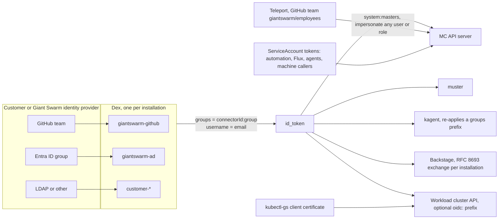
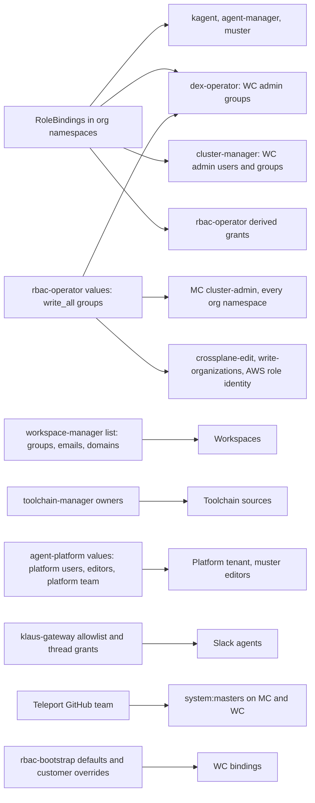
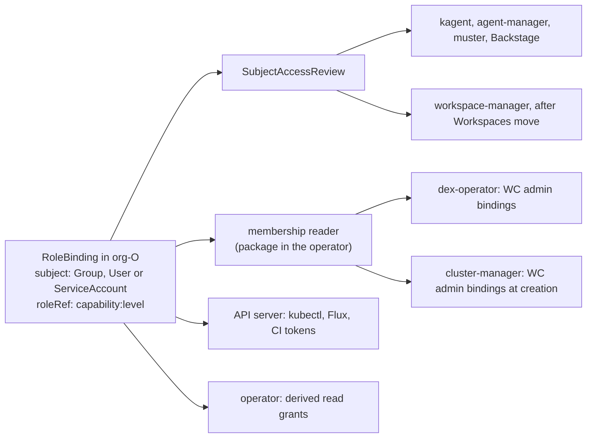
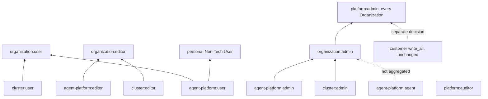
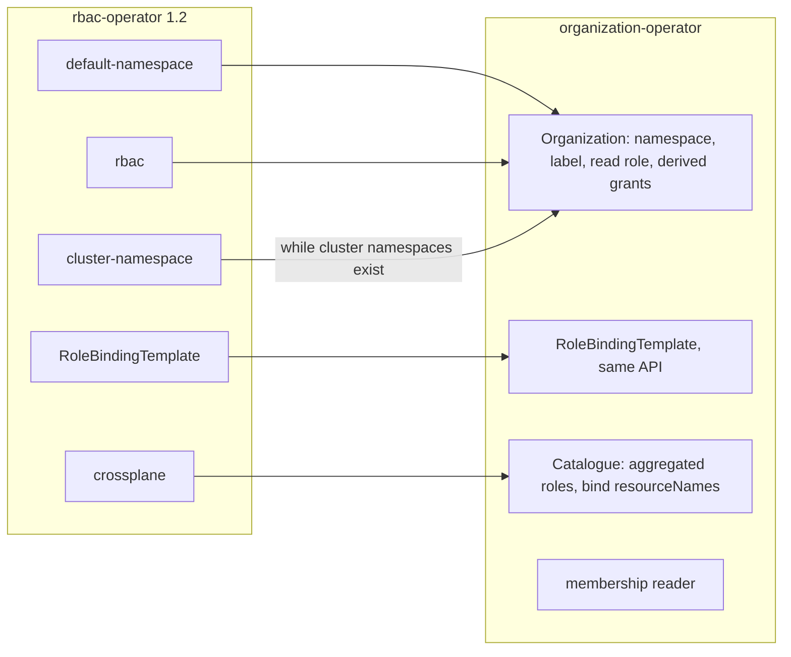
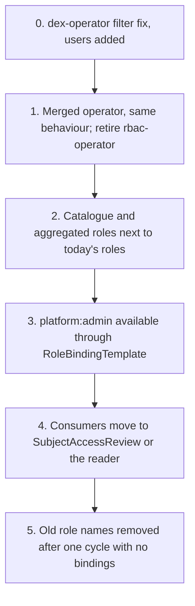

# Organization roles: one membership source, one operator

## Objective

Make "person X has role R in Organization O" mean one thing on the platform, so that the KaaS platform and the agent platform share one membership source and one role vocabulary, and so that a new platform has one pattern to follow.

This RFC covers the management cluster, the workload clusters it creates, and the agent platform. Observability is described as a follow-up (see [Follow-up: observability](#follow-up-observability)).

## Background

This section describes what exists today. Every statement comes from code on `main` as of 2026-10-27; the sources are in the [appendix](#appendix-a-role-inventory). Diagrams and the full inventory are also on the [Miro board](https://miro.com/app/board/uXjVEVa-IFw=).

### Identity: where a subject comes from

Every installation runs its own Dex (`dex-app`), configured by dex-operator. A person signs in through one connector: `giantswarm-github` or `giantswarm-ad` for Giant Swarm staff, `customer-<name>` for the customer's identity provider (Entra ID, GitHub, or any Dex connector type). The token carries `email` as the username and `groups` as the group list.

Our Dex fork prefixes every group with the connector ID, so a group is spelled `giantswarm-ad:giantswarm-admins` or `customer:giantswarm:Employees`. This is a Giant Swarm convention, not an OIDC standard; upstream Dex declined the feature. The management cluster API server sets no further prefix. Some workload clusters add `oidc:` through structured authentication, and kagent re-applies a prefix of its own. That is why one RoleBinding subject can be spelled three ways.

A RoleBinding subject can therefore be a `Group` (connector-prefixed), a `User` (the email), or a `ServiceAccount`. Three paths bypass Dex: Teleport for Giant Swarm staff, kubectl-gs client certificates for workload clusters (any group, for whoever can read the cluster CA Secret), and ServiceAccount tokens.

### Who accesses the platform today

| Who | Signs in through | What binds them | What they get | Scope |
|---|---|---|---|---|
| Customer admin | Dex, customer connector | `write_all` groups in rbac-operator values | `cluster-admin` on the whole MC and in every Organization namespace, `write-organizations`, `crossplane-edit`, AWS role identities, cluster-admin on every workload cluster | Installation |
| Customer reader | Dex | `read_all_groups` (defined in rbac-operator, never set by shared-configs) | `read-all` cluster-wide | Installation |
| Organization member | Dex | A RoleBinding the customer creates in `org-<name>` (`read-all`, `write-in-cluster-ns`, `cluster-admin`) | That role, plus derived read access to the Organization, releases and catalogs | One Organization |
| Customer CI | ServiceAccount token | `automation` in `default` and in every `org-*`, created by rbac-operator | `cluster-admin` in its Organization, plus cluster-wide extras (silences, policy exceptions, client certificates, Crossplane, chart lookups) | Installation |
| Flux | ServiceAccount | RoleBindingTemplates | `cluster-admin` in every Organization namespace | Installation |
| Giant Swarm admin | Dex, GS connector | `giantswarm.write_all` groups | `cluster-admin` cluster-wide | Installation |
| Giant Swarm staff | Teleport | Teleport `giantswarm` role | `system:masters` on every MC and WC, may impersonate any user or role | Fleet |
| Backstage user | Dex, exchanged per installation | Their own Dex groups | Whatever their bindings allow; Backstage runs as the person | Per person |
| Agent platform user | Dex | `agent-platform:platform-user` bound to `system:authenticated` in `kagent`; `agent-platform:user/editor/admin` bound by hand in `org-*` | Run platform agents; per-Organization rights only where someone created a binding | Platform tenant, Organization |
| Slack user | Slack, linked to Dex via muster | klaus-gateway thread grants and channel allowlist, then the person's own token | Talk to an agent as themselves | Per thread |
| Agent | ServiceAccount token | `system:serviceaccount:org-<name>:<agent>` (T9 decision on giantswarm#36698) | Reviewed as the agent and as the person; both must allow | One Organization |
| Workspace member | Dex | workspace-manager's own list of groups, emails and domains | Create and use Workspaces, which all live in the `kagent` namespace | Not Organization-aware |
| Workload cluster user | WC Dex or OIDC | `rbac-bootstrap` bindings composed by dex-operator and cluster-manager from the Organization's `cluster-admin` bindings, or customer overrides | `cluster-admin` on the cluster | One cluster |

### Where membership is decided today

Four things follow from this picture:

1. **Group lists live in nine places**, counted in the appendix. The same Giant Swarm groups are repeated in four or more value keys and differ per installation.
2. **Three readers already derive membership from Organization RoleBindings**: rbac-operator (derived read grants), dex-operator (workload-cluster admin groups), and cluster-manager (workload-cluster admin users and groups at creation). dex-operator's filter has a bug: a RoleBinding to any ClusterRole counts, so a `read-all` subject becomes a workload-cluster admin.
3. **An Organization namespace is defined three ways**: by the label `giantswarm.io/organization` (kagent, agent-manager's reconciler, the agent-platform chart), by the `org-` name prefix (rbac-operator, muster, Backstage, agent-manager's workload-cluster target), or not at all (workspace-manager's free-form string).
4. **A customer cannot make someone admin of one Organization** without making them admin of all of them, because the admin group is bound by installation values.

### Special cases that must keep working

These exist today and the proposal must not break them.

- `org-giantswarm` is protected: no customer admin binding, and only `flux-system` or same-namespace ServiceAccounts through RoleBindingTemplates.
- Namespaces with the legacy `customer` label are still treated as Organization namespaces.
- Cluster namespaces (`giantswarm.io/organization` plus `giantswarm.io/cluster`) exist on older installations. rbac-operator resolves their Organization by name, then by the annotation `ui.giantswarm.io/original-organization-name`.
- Organization names starting with `default`, `kube-`, `monitoring`, `gatekeeper` or `draughtsman` are refused.
- On CAPA, customer admins hold `write-aws-cluster-role-identity`. Where Crossplane is installed, customer admins and every automation ServiceAccount hold `crossplane-edit`.
- Flux controllers hold `cluster-admin` in every Organization namespace through the `flux-namespace-reconciler` template.
- happa and Backstage discover a person's Organizations through `get` on each `organizations/<name>`, not through `list`. rbac-operator grants that `get` to every subject bound in the namespace.
- Teleport refuses to impersonate customer groups, so Backstage's Clusters page checks access with `SubjectAccessReview`.
- Workload clusters: `rbac-bootstrap` is on for AWS and Azure and off for EKS (cloud access entries govern there). A customer's `rbacBootstrap` values replace the whole binding list, which drops the Giant Swarm `view` bindings. kubectl-gs client certificates can carry any group, including `system:masters`.
- Agent platform: the platform tenant is the `kagent` namespace, bound to `system:authenticated` (which includes every ServiceAccount). Session shares, workspace grants, klaus-gateway thread grants and channel allowlists are runtime grants, not membership. `models.<domain>` accepts any Dex token with audience `dex-k8s-authenticator` for any model.

### Drift found on the way

- `write-flux-resources` has a misspelled API group and is bound to nobody.
- `read_all_groups` is a rbac-operator value that shared-configs never passes.
- `write-silences` covers only the legacy v1alpha1 Silence group and is bound only to the automation ServiceAccount.
- The agent-platform values say `tenants.platform.users` binds `agent-platform:user`; the template binds `platform-user`.
- `kamaji-datastore-manager` is bound to every automation ServiceAccount but no definition of the role was found.
- The docs recipe for an automation token expects a token Secret that no longer exists.
- Ten security findings were reviewed and eight confirmed in code. They are tracked through the security process, not here. Some are prerequisites below.

## Proposal

### One membership source, one reader

"Person X has role R in Organization O" means exactly one thing: a RoleBinding in `org-O` that binds X, or one of X's groups, to R.

There are two kinds of consumer, and only two:

- **Runtime checks** ask the API server with `SubjectAccessReview`. kagent, agent-manager, muster and Backstage already do. workspace-manager joins once Workspaces live in the Organization namespace.
- **Projections** need a list: a workload cluster's admin bindings cannot be looked up on the management cluster at request time. One package in the operator, the membership reader, answers "subjects holding role R in Organization O", resolving aggregated roles and RoleBindingTemplates. It returns Users, Groups and ServiceAccounts. It replaces the three readers that exist today and removes dex-operator's filter bug. Organization status holds no copy of the membership.

No other component keeps a list of people.

What stays outside membership, unchanged: kagent session shares, workspace grants, klaus-gateway thread grants and channel allowlists, and data-source checks that use the person's own GitHub or GitLab access.

### Roles per capability and level

Role names keep the existing `capability:level` form. Every role is a ClusterRole bound per Organization namespace.

| Role | Grants | Replaces today | Owner |
|---|---|---|---|
| `agent-platform:user` / `:editor` / `:admin` | Run agents; write agents, workspaces and remote MCP servers; manage models, model keys, egress and connector credentials | The existing roles, muster `mcpserver-editor` and `workflow-editor`, the workspace-manager list | Bumblebee |
| `agent-platform:agent` | What an agent needs about itself: its Agent, its Sessions, its memory. Bound to `system:serviceaccounts:org-<name>`. Not aggregated into any admin role. | kagent's default actor policy | Bumblebee |
| `cluster:user` / `:editor` / `:admin` | See the Organization's clusters and apps; create and upgrade clusters and install apps; cluster-admin on the Organization's workload clusters, client certificates and policy exceptions. No Secrets below admin. | `read-in-cluster-ns`, `write-in-cluster-ns`, the `cluster-admin` RoleBinding in the Organization namespace | Shield (Honeybadger for apps) |
| `organization:user` / `:editor` / `:admin` | Aggregates of every capability role at that level. `organization:admin` may bind only catalogue roles: no `escalate`, no `serviceaccounts/token`, no `pods/exec`. | Ad hoc bindings; the customer admin RoleBinding per namespace | Shield |
| `platform:admin` | Every capability admin in every Organization, plus creating Organizations | New. Offered next to `write_all`, which stays as it is | Shield |
| `platform:auditor` | Read everything except Secrets and ConfigMaps, plus policy reports | `read-all` | Shield |
| Personas: KaaS Platform User, Non-Tech User, Security Auditor | Aggregated from the capability roles, for example Non-Tech User = `agent-platform:user` | Ad hoc bindings | Shield; each platform labels its roles |

Finer roles come later by splitting a role and aggregating the parts back under the same name, so existing bindings keep working.

The derived read grants stay: every subject bound to anything in an Organization namespace keeps `get` on its Organization and read access to releases and catalogs. That is how the portals list a person's Organizations, and it also covers Roles a customer writes themselves (see Decisions). Aggregation cannot express "whoever is bound to anything", so the operator keeps doing it.

The customer `write_all` groups keep their cluster-wide `cluster-admin`. Narrowing that is a Shield security decision on its own. `platform:admin` is the narrower role an installation can bind instead, through a RoleBindingTemplate.

The automation ServiceAccounts and their cluster-wide extras are carried over unchanged. One guard applies to the whole catalogue: no role grants `serviceaccounts/token` or `escalate`, so an Organization admin cannot mint the automation token. That is already true of `agent-platform:admin`.

### Merge organization-operator and rbac-operator

Both operators are owned by Shield and work on the same objects. organization-operator (v2.x) is on controller-runtime. rbac-operator has moved its RoleBindingTemplate controller to controller-runtime ([rbac-operator#683](https://github.com/giantswarm/rbac-operator/pull/683)); its four other controllers still run on operatorkit ([roadmap#3056](https://github.com/giantswarm/roadmap/issues/3056)). We finish that migration by moving those controllers into organization-operator.

- **CRDs.** `Organization` (`security.giantswarm.io`) and `RoleBindingTemplate` (`auth.giantswarm.io`) keep their API groups and versions. No consumer changes.
- **Carried over unchanged.** RoleBindingTemplate; the `automation` ServiceAccounts with their bindings; the Flux bindings (scope reviewed, see Prerequisites); release and catalog read grants; the derived grants; `write-organizations`; the Crossplane and CAPA bindings; app-operator RBAC in cluster namespaces while those exist; the `org-giantswarm` protection; the legacy `customer` label.

### The contract a platform follows

The merged operator is what every platform reuses. It relies on Kubernetes [aggregated ClusterRoles](https://kubernetes.io/docs/reference/access-authn-authz/rbac/#aggregated-clusterroles) and the [`bind` verb](https://kubernetes.io/docs/reference/access-authn-authz/rbac/#restrictions-on-role-binding-creation-or-update), not on a new API.

1. A platform ships its ClusterRoles in its own chart, named `<capability>:<level>`. Each carries the label `organization.giantswarm.io/role: "true"` and the `organization.giantswarm.io/aggregate-to-<level>` labels of the roles it joins. `user` roles also carry `rbac.authorization.k8s.io/aggregate-to-view` and `editor` roles `aggregate-to-edit`, so the built-in `view`, `edit` and `admin` roles keep working for customers who bind those.
2. The operator owns the aggregated roles: `organization:*`, `platform:*` and the personas. A labelled role joins them with no change to the operator. The operator ignores a labelled role whose name is not `<capability>:<level>` with a known level.
3. The operator keeps the `bind` `resourceNames` of `organization:admin` in sync with the labelled roles. Kubernetes' escalation checks do the rest.
4. For each Organization, the operator creates the namespace with the `giantswarm.io/organization` label (the only definition of an Organization namespace), the `organization-<org>-read` role, the derived grants, and the default bindings from RoleBindingTemplates.
5. Runtime checks use `SubjectAccessReview`. Projections use the membership reader.

The test of this design: Bumblebee adds `agent-platform:*`, and later Atlas adds `observability:*`, with changes to their own charts only.

### Workload clusters

A workload cluster's admin bindings are composed from the Organization's `cluster:admin` bindings through the membership reader, in both places that write them today: dex-operator (`<cluster>-default-auth-config`) and cluster-manager (at creation). The `rbac-bootstrap` format already takes users and groups, so `User` subjects are projected too. Customer `rbacBootstrap` overrides stay; the operator should keep the Giant Swarm `view` bindings when a customer overrides the list. Client certificates require `cluster:admin`.

## Follow-up: observability

Observability is not Organization-shaped today: a `GrafanaOrganization` holds its own group lists and several tenants, nothing links a tenant to an Organization, `org_mapping` is written only on management clusters, the Teleport sign-in path makes staff Admin of two Grafana organizations regardless of those lists, and writing into a tenant is open to anyone who can label a workload. Mapping Organizations onto Grafana organizations and tenants is a product decision for Atlas.

This RFC gives Atlas the contract: ship `observability:viewer/editor/admin` with the labels above, and project Grafana roles through the membership reader. The mapping rule, the Teleport path and tenant write scoping are theirs to decide in a follow-up RFC.

## Capability check

Every capability we have today and where it goes. "Decide" rows need an answer before approval.

| Today | In this proposal | Status |
|---|---|---|
| RoleBindingTemplate | Same CRD, merged operator | Kept |
| Customer `write_all` groups: cluster-admin cluster-wide and per Organization | Unchanged. `platform:admin` offered next to it | Kept |
| `read-all` | `platform:auditor` | Mapped |
| Automation ServiceAccounts with cluster-wide extras | Unchanged | Kept |
| Flux as cluster-admin in Organization namespaces | A per-Organization Flux ServiceAccount at editor level; Giant Swarm-owned Flux objects get their own | Changed |
| Derived grants: Organization `get`, releases, catalogs for every bound subject | Kept in the operator | Kept |
| `read-in-cluster-ns`, `write-in-cluster-ns`, app-operator RBAC in cluster namespaces | `cluster:user` / `cluster:editor`; kept while cluster namespaces exist | Mapped |
| App configuration Secrets written through `write-in-cluster-ns` | `cluster:editor` has no Secrets. Options: External Secrets or SOPS only, or create without read | **Decide** |
| `write-organizations` | Kept, next to `platform:admin` | Kept |
| `write-client-certificates`, kubectl-gs client certificates | `cluster:admin` only | Mapped |
| `write-aws-cluster-role-identity`, `crossplane-edit` | Carried over for `write_all`; a capability role if an owner wants one | Kept |
| Workload-cluster admin from dex-operator and cluster-manager | From `cluster:admin` bindings, through the membership reader, users included | Changed |
| Customer `rbacBootstrap` overrides | Kept; Giant Swarm `view` bindings preserved | Kept |
| Do workload-cluster roles follow Organization bindings or stay per cluster | | **Decide** |
| `agent-platform:platform-user` for every signed-in person in `kagent` | Kept. Whether `system:authenticated` (which includes ServiceAccounts) stays the subject | **Decide** |
| muster `mcpserver-viewer`, `mcpserver-editor`, `workflow-editor` | `agent-platform:user` and `:editor` | Mapped |
| Agent identity and the both-must-allow rule | `agent-platform:agent` | Mapped |
| Machine callers and session readers (TokenReview allowlists) | Unchanged | Kept |
| workspace-manager members by group, email and domain | RoleBindings, once Workspaces move. Domain membership is dropped; an IdP group per domain replaces it | Changed |
| toolchain-manager owners | A RoleBinding on toolchain sources in the platform tenant | Changed |
| Session shares, workspace grants, klaus-gateway grants and allowlists | Unchanged, not membership | Kept |
| `models.<domain>` open to any Dex token; API keys reach every model | Out of scope here; tracked in giantswarm#37742 | Open |
| Grafana roles, tenants, silences, Alertmanager configuration | Follow-up RFC by Atlas | Follow-up |
| Teleport and Giant Swarm staff groups | Unchanged | Kept |

## Prerequisites

Before any new role ships:

0. dex-operator's binding filter is fixed and its projection includes users.
1. Workload-cluster admin bindings come only from `cluster:admin` bindings, through the membership reader, in dex-operator and cluster-manager.
2. In Organization namespaces, Flux runs only as the Organization's Flux ServiceAccount: `--default-service-account`, `--no-cross-namespace-refs`, and a stricter `flux-multi-tenancy` policy. Without this, editor is the same as admin.
3. One definition of an Organization namespace, the label. muster, Backstage, agent-manager's workload-cluster target and rbac-operator's key package drop the `org-` prefix rule.
4. One group spelling: the Dex connector-prefixed form. kagent stops re-applying a prefix; `oidc:` bindings on workload clusters are rewritten, with a report per installation.
5. Workspaces move to the Organization namespace.

## Migration

1. Ship the merged operator with the current behaviour and retire rbac-operator.
2. Ship the catalogue and aggregated roles next to today's roles. Existing role names aggregate into the new ones, so current bindings keep working.
3. Offer `platform:admin` through a RoleBindingTemplate for installations that want a narrower admin than `write_all`.
4. Move each consumer: dex-operator and cluster-manager to the reader; muster and workspace-manager to `SubjectAccessReview`. Remove their group-list values.
5. Remove old role names after one release cycle with no bindings left.

## Alternatives considered

- **A relationship store (OpenFGA or similar).** Rejected in the agent-permissions plan (giantswarm/bumblebee-plans#78): a second source of truth next to Kubernetes RBAC.
- **A membership CRD on the Organization.** Rejected: it would be a copy of the RoleBindings and would need its own authorizer.
- **A `giantswarm:` prefix on role names.** Not needed: Kubernetes reserves only `system:`, discovery is by label, and the existing `agent-platform:*` bindings are few. The operator guards against malformed names instead.
- **Replacing `write_all` with `platform:admin` now.** Deferred: it changes what every customer admin can do outside Organization namespaces and needs a security decision of its own.

## Open questions

- Do we need a team below the Organization, or is the Organization the team and the cost centre?
- Do workload-cluster roles follow Organization bindings, or stay per cluster?
- Who should see the Shared Org and the `giantswarm` tenant? (Carried to the observability follow-up.)
- MCP server and workspace app grants differ, and there is no per-agent limit yet. Does that need a role?

## References

- [Authorization in the platform API](https://docs.giantswarm.io/tutorials/access-management/authorization/) (today's documented roles and automation)
- [Agent permissions PRD](https://github.com/giantswarm/bumblebee-plans/blob/main/agent-permissions/PRD.md) (giantswarm/bumblebee-plans#78)
- [Human permissions on agents](https://github.com/giantswarm/giantswarm/issues/36698), including the T9 decision on agent identity
- [rbac-operator migration to kubebuilder](https://github.com/giantswarm/roadmap/issues/3056), [rbac-operator#683](https://github.com/giantswarm/rbac-operator/pull/683)
- Kubernetes: [aggregated ClusterRoles](https://kubernetes.io/docs/reference/access-authn-authz/rbac/#aggregated-clusterroles), [restrictions on role binding creation](https://kubernetes.io/docs/reference/access-authn-authz/rbac/#restrictions-on-role-binding-creation-or-update)
- [Miro board](https://miro.com/app/board/uXjVEVa-IFw=): inventory with sources, drift, and the earlier role proposals

## Decisions

### 2026-10-27 Customers build their own roles inside their Organization

Customers create Roles in their own Organization namespace, limited to rights they already hold. A security review happens before this ships.

### 2026-10-27 Both write-organizations and an Organization manager are supported

Installation-wide Organization creation stays available, next to a role that manages one Organization.

### 2026-10-27 Roles are per capability now, finer roles come later by splitting

A split role is aggregated back under its old name, so existing bindings keep working.

### 2026-10-27 Role names keep the capability:level form without a gs: prefix

This matches the existing `agent-platform:*` roles. Discovery is by label; the operator ignores malformed names.

### 2026-10-27 Harnesses stay in the kagent namespace for everyone

There are no copies of a harness per tenant.

### 2026-10-27 Customer write_all stays; platform:admin is offered next to it

Narrowing the customer admin group's cluster-wide rights is a separate security decision.

### 2026-10-27 Derived read grants stay in the operator

Every subject bound in an Organization namespace keeps `get` on the Organization and read access to releases and catalogs.

### 2026-10-27 Observability joins through a follow-up RFC

This RFC covers the management cluster, workload clusters and the agent platform. Atlas maps Organizations onto Grafana organizations and tenants in their own RFC.

## Appendix A: role inventory

Every role and membership list that exists today. Source is `repo:path` on `main`, 2026-10-27.

| Role or list | System | Grants | Subjects come from | Organization-aware | Source |
|---|---|---|---|---|---|
| `Organization` CR and `org-<name>` namespace | KaaS MC | Namespace with the `giantswarm.io/organization` label; spec is empty | Whoever holds `write-organizations` | Per org | organization-operator |
| `write-all-customer-group` (ClusterRoleBinding) | KaaS MC | `cluster-admin` on the whole MC | `oidc.customer.write_all_groups` | Installation | rbac-operator: defaultnamespace/resource/usergroups |
| `write-all-customer-group` (RoleBinding in every org namespace) | KaaS MC | `cluster-admin` | Same groups | Installation | rbac-operator: rbac/resource/namespaceauth |
| `write-all-giantswarm-group` | KaaS MC | `cluster-admin` | `oidc.giantswarm.write_all_groups` | Installation | rbac-operator: usergroups |
| `read-all`, `read-all-customer-group` | KaaS MC | get, list, watch on everything except Secrets and ConfigMaps | customer `write_all` and `read_all` groups | Installation | rbac-operator: clusterroles |
| `write-organizations` | KaaS MC | All verbs on Organizations | customer `write_all`, `default/automation` | Installation | rbac-operator: usergroups |
| `organization-<org>-read` | KaaS MC | `get` on that Organization | Every subject bound in the org namespace | Per org | rbac-operator: externalresources |
| `read-in-cluster-ns`, `write-in-cluster-ns` | KaaS MC | Marker roles; apps, ConfigMaps and Secrets in cluster namespaces | Copied from `read-all` and `cluster-admin` bindings | Per org | rbac-operator: clusternamespace |
| `read-releases`, `read-default-catalogs` | KaaS MC | Read releases and catalogs | Every subject bound in any org namespace | Per org | rbac-operator: externalresources |
| `automation` ServiceAccount | KaaS MC | `cluster-admin` per org; cluster-wide `write-silences`, `write-policy-exceptions`, `write-client-certificates`, `cluster-app-chart-lookups`, `kamaji-datastore-manager`, `crossplane-edit`; `patch-charts` | Fixed; token minted by anyone admin in the namespace | Installation | rbac-operator: automationsa, rbac/resource/automation |
| `write-flux-resources` | KaaS MC | Flux CRs (API group misspelled) | Nobody | Not aware | rbac-operator: clusterroles |
| `RoleBindingTemplate` | KaaS MC | Any RoleBinding stamped into matching Organizations | Whoever writes the template | Per org | rbac-operator: rolebindingtemplate |
| Flux bindings | KaaS MC | `cluster-admin` in every org namespace, `crd-controller` | Flux controller ServiceAccounts | Not aware | rbac-operator: fluxauth |
| `crossplane-edit` | KaaS MC | Crossplane edit | customer `write_all`, every automation SA | Installation | rbac-operator: crossplane |
| app-operator RBAC per cluster namespace | KaaS MC | Apps and catalogs for that namespace's app-operator | Operator-internal | Not aware | rbac-operator: clusternamespace |
| WC admin bindings | Workload cluster | `cluster-admin` | `write_all` groups plus Group subjects bound in the org namespace | Per org | dex-operator: pkg/auth/auth.go |
| WC admin bindings at creation | Workload cluster | `cluster-admin` | Creator plus `cluster-admin` subjects in the org namespace | Per org | cluster-manager: internal/tools/cluster_rbac.go |
| `view-0`, `cluster-reader` | Workload cluster | view plus nodes, PVs, CRDs | Four hard-coded GS groups | Not aware | cluster chart: rbac-bootstrap |
| Customer `rbacBootstrap` values | Workload cluster | Anything | Customer values, replace the list whole | Per org | cluster chart |
| kubectl-gs client certificates | Workload cluster | Any group | Whoever reads the cluster CA Secret | Per org | kubectl-gs: cmd/login |
| Teleport `giantswarm` role | Fleet | `system:masters`, impersonate any user or role | GitHub team `giantswarm/employees` | Not aware | teleport-fleet |
| `agent-platform:user/editor/admin` | Agent platform | See and run agents; write agents; models, egress, RoleBindings | RoleBindings created by hand per org | Per org | agent-platform: connectivity/templates/tenants |
| `agent-platform:platform-user`, editors in `kagent` | Agent platform | Platform agents for everyone; platform team edits | `tenants.platform.users`, `.editors`, `tenants.platformTeam` | Platform tenant | agent-platform: tenants/platform-tenant.yaml |
| muster `mcpserver-viewer`, `mcpserver-editor`, `workflow-editor` | Agent platform | List and write MCPServers and Workflows | `tenants.platform.users`, muster `rbac.*.subjects` | Platform tenant | muster chart |
| kagent authorizer, sessions, shares | Agent platform | SubjectAccessReview per call; share tokens | Kubernetes RBAC plus runtime shares | Per org | kagent-upstream: go/core/pkg/auth |
| Machine callers, session readers | Agent platform | ServiceAccount allowlists by TokenReview | agent-platform values | Platform | kagent-extensions, kagent |
| workspace-manager organizations | Agent platform | Create and use Workspaces | Groups, emails, domains in values | Not aware | workspace-manager: internal/workspace/access.go |
| toolchain-manager owners | Agent platform | Approve toolchain sources | Groups and emails in values | Not aware | toolchain-manager: internal/sources |
| klaus-gateway allowlist, thread grants, allowed callers | Agent platform | Who may talk to an agent in Slack | Channel IDs, runtime grants, SA list | Not aware | klaus-gateway: pkg/channels/slack |
| `models.<domain>` JWT policy, llmRouting API keys | Agent platform | Any model | Any Dex token with the audience; API keys | Not aware | agent-platform: connectivity |
| Backstage permission policy | Portal | Allow all; data access as the person | Sign-in resolver | Not aware | backstage: packages/backend |
| Dex group prefix | Identity | Groups become `connectorId:group` | Connector IDs | Not aware | giantswarm/dex: server/handlers.go |
| `GrafanaOrganization` Admin, Editor, Viewer | Observability | Grafana org role | Group strings in `spec.rbac` | Not aware | observability-operator |
| Default Grafana orgs: Giant Swarm, Shared Org, Giant Swarm Security | Observability | Shared Org viewer for everyone | shared-configs values | Installation | shared-configs |
| Grafana Teleport sign-in | Observability | Admin of Shared Org and Giant Swarm | Any valid Teleport token | Not aware | shared-configs: grafana |
| Tenant write, Silences, Alertmanager config | Observability | Ship data into a tenant; silence; configure | Anyone who can label a workload or create the object | Not aware | observability-operator, silence-operator |
