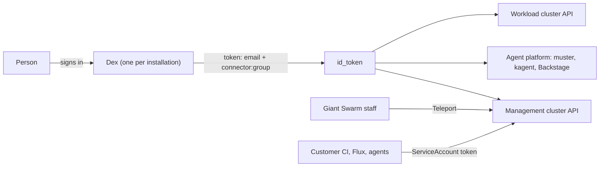
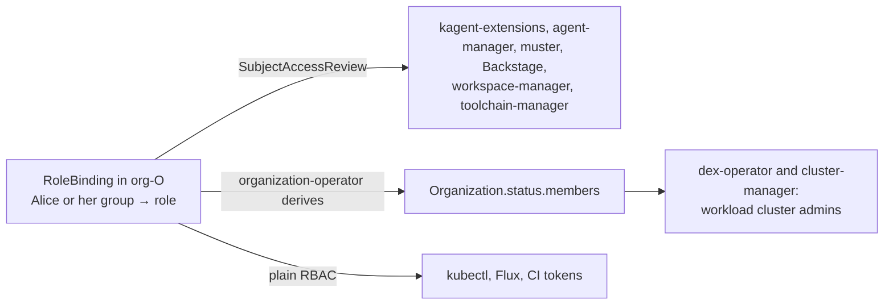
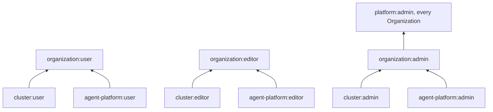
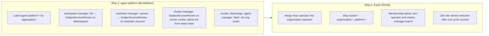

# Organization roles: one membership source, one operator

## TL;DR

- Today, "who belongs to an Organization" is answered differently by every product. Group lists live in nine places. A customer cannot make someone admin of one Organization without making them admin of all of them.
- We propose one rule: a person has a role in an Organization when a RoleBinding in that Organization's namespace says so. Nothing else holds a list of people.
- Roles get one naming scheme, `<capability>:<level>`, for example `cluster:admin` or `agent-platform:user`. Each platform ships its own roles; the operator combines them into `organization:user`, `organization:editor`, `organization:admin` and `platform:admin`.
- Checks happen in two ways only: ask the API server (`SubjectAccessReview`), or, where a system cannot ask (workload clusters), read the membership the operator derives from the bindings and publishes on the Organization's status.
- We do it in two steps. Step 1 is the agent platform alone: the workspace, cluster and toolchain managers drop their own lists and use the `agent-platform:*` roles. Step 2 merges rbac-operator into organization-operator and adds the KaaS roles.
- Customers lose nothing. Their admin group, their automation ServiceAccounts and their existing bindings keep working. New roles arrive next to the old ones, and old names are removed only after nobody uses them.
- Observability joins later, through its own RFC by Atlas.
- Five questions need an answer before approval (see [Still to decide](#still-to-decide)). The first one decides whether the per-Organization promise can be made at all.

## The problem, in plain words

A customer has two teams, Payments and Search, each with its own Organization. They want Alice to be admin of Payments and nothing else. Today they cannot do that cleanly:

- The customer's admin group is set in installation values. rbac-operator binds it to `cluster-admin` on the whole management cluster and in every Organization namespace. Alice is either admin everywhere or not admin.
- If the customer writes a RoleBinding for Alice in `org-payments`, three different programs read it and draw their own conclusions: rbac-operator (read access to releases and catalogs), dex-operator (admin on the workload clusters), cluster-manager (admin on new clusters). dex-operator reads it wrong: it treats a read-only binding as an admin binding.
- The agent platform has its own roles, `agent-platform:user`, `editor` and `admin`, bound by hand. Its managers do not use them: workspace-manager keeps a list of groups and emails, toolchain-manager keeps a list of owners, cluster-manager reads the KaaS `cluster-admin` bindings itself.
- What "an Organization namespace" is depends on the program: some look for the label `giantswarm.io/organization`, some for the `org-` name prefix, one accepts any string.
- Even the group name is spelled differently: Dex prefixes it with the connector name, some workload clusters add `oidc:`, and the agent platform mirrors the API server's prefix flag per installation.

So a new product has no pattern to follow, each product invents its own, and the customer has to learn all of them.

## How it works today

Every installation has one Dex. A person signs in through a connector (`giantswarm-github`, `giantswarm-ad`, or the customer's own). The token names the person by email and lists their groups as `<connector>:<group>`, for example `customer:platform-admins`. That token is what the management cluster, muster, kagent, Backstage and the workload clusters see.

Three paths bypass Dex: Teleport for Giant Swarm staff (`system:masters` everywhere), client certificates for workload clusters, and ServiceAccount tokens (customer CI, Flux, machine callers).

Who decides what that person may do:

| Question | Answered by | Where the list lives |
|---|---|---|
| Is this person a customer admin? | rbac-operator | Installation values (`write_all` groups) |
| May they read this Organization? | rbac-operator, from any RoleBinding in the namespace | The RoleBinding |
| Are they admin on the Organization's workload clusters? | dex-operator and cluster-manager, from `cluster-admin` RoleBindings | The RoleBinding, plus the `write_all` groups |
| May they run this agent? | kagent-extensions, by asking the API server | The RoleBinding |
| May they write MCP servers? | muster, with the person's own token | A RoleBinding in muster's namespace |
| May they use this Workspace? | workspace-manager | Its own list of groups, emails and domains |
| May they add a toolchain? | toolchain-manager | Its own list |
| Who sees the platform's agents? | The agent-platform chart | `system:authenticated` |

The full inventory, with sources, is in [Appendix A](#appendix-a-everything-that-grants-access-today).

## What we propose

### One rule for membership

"Alice has role R in Organization O" means: there is a RoleBinding in `org-O` that binds Alice, or one of her groups, to R. That is the only place membership is written.

Every program that needs an answer gets it in one of two ways:

1. **Ask the API server.** A `SubjectAccessReview` asks "may this user do this verb on this resource in this namespace". kagent-extensions, agent-manager, muster and Backstage already work this way. workspace-manager and toolchain-manager will. The verb and resource each decision asks for are fixed in [Appendix E](#appendix-e-role-rules-and-decision-tuples), so two programs asking the same question get the same answer.
2. **Read the membership the operator derives.** A workload cluster cannot ask the management cluster at request time; its admin list has to be written into it. The operator reads the RoleBindings of each Organization, resolves RoleBindingTemplates and the `write_all` groups, and publishes the result on `Organization.status.members` as "role, then subjects". The operator is the only writer. dex-operator and cluster-manager read the status instead of the bindings; the three readers of today, each with its own bugs, become one. The status is a derived cache of the bindings, not a second place to write membership: nobody authorizes against it, and a RoleBinding change is reflected on the next reconcile.

Runtime grants stay what they are and are not membership: sharing a session, granting a Slack thread, allowing a channel.

**Revocation is eventual, with bounds.** Removing a RoleBinding takes effect on the management cluster API at once. The agent platform reuses a `SubjectAccessReview` answer for the same subject, verb and resource for a short time (kagent-extensions: 10 seconds by default), so a removed binding stays effective there for at most that long. On workload clusters, the status is recomputed on the operator's next reconcile and dex-operator rewrites the bindings on its own; the target is under one minute on the management cluster and under five minutes on a workload cluster. Both bounds are stated so a customer does not assume removal is instant everywhere.

### One naming scheme for roles

Roles are ClusterRoles named `<capability>:<level>`, bound per Organization namespace. Each platform owns its capability. The rules of every role, as shipped today or as proposed, are in [Appendix E](#appendix-e-role-rules-and-decision-tuples).

| Role | What it allows | Owner |
|---|---|---|
| `agent-platform:user` / `editor` / `admin` | Run agents; write agents, workspaces and toolchains; manage models, keys, credentials and MCP servers | Bumblebee |
| `cluster:user` / `editor` / `admin` | See the Organization's clusters and apps; create and upgrade clusters and install apps; full admin on the Organization's workload clusters | Shield (apps: Honeybadger) |
| `organization:user` / `editor` / `admin` | Everything the capability roles allow at that level, combined | Shield |
| `platform:admin` | `organization:admin` in every Organization, plus creating Organizations | Shield |
| `platform:auditor` | Read everything except Secrets and ConfigMaps | Shield |

MCP servers stay at the admin level, as the agent-permissions plan decided (D9): an MCPServer carries credentials and reaches the network. Widening that to editors later is a non-breaking change and gets its own decision.

Agent and machine identity (an agent as a subject of its own, next to the person it acts for) is not defined in this RFC. It is tracked on giantswarm#36698. Until it lands, an agent acts with exactly the rights of the person who runs it.

The `organization:*` and `platform:*` roles are Kubernetes [aggregated ClusterRoles](https://kubernetes.io/docs/reference/access-authn-authz/rbac/#aggregated-clusterroles): the operator builds them from every capability role that carries the matching label. A platform adds a capability by shipping a labelled ClusterRole in its own chart. No change to the operator.

An `organization:admin` may create RoleBindings in their Organization, but only to catalogue roles. Kubernetes enforces this through the `bind` verb limited by `resourceNames`; the operator keeps that list current. No catalogue role grants `escalate`, `serviceaccounts/token`, or read access to Secrets. `agent-platform:admin` keeps create, update and delete on Secrets without get, list or watch, so an admin can place a credential but never read one back; `cluster:admin` follows the same pattern (see [Still to decide](#still-to-decide) 2 for app configuration).

We propose that customers may also write their own Roles inside their Organization namespace. Kubernetes limits such a Role to rights the author already holds. A security review happens before this ships.

Finer roles can come later: split a role, and aggregate the parts back under the old name, so existing bindings keep working. We propose per-capability roles now and finer ones only by splitting.

Role names keep the `<capability>:<level>` form without a `giantswarm:` prefix. This matches the existing `agent-platform:*` roles, and discovery is by label.

#### Mechanics

Three details that the design depends on:

- **The `bind` rule lives in its own labelled ClusterRole.** The rules of an aggregated ClusterRole are computed by the controller-manager from the labelled roles and overwrite anything written there directly. The operator therefore maintains a small ClusterRole (`organization:admin-bind`) that carries the `bind` verb with the current `resourceNames` list and aggregates into `organization:admin`. The list is built from a label of its own, so `platform:*` roles are never bindable by an Organization admin.
- **Customer-authored RoleBindings may not name `system:` subjects.** RBAC restricts which role a subject may bind, never which subject. Without a guard an `organization:admin` can bind `cluster:user` to `system:unauthenticated` or `system:authenticated`, and the derived read grants would follow. A validating policy (Kyverno or ValidatingAdmissionPolicy, owned by Shield) refuses RoleBindings in Organization namespaces whose subjects start with `system:` unless the writer is the operator.
- **`platform:admin` needs a ClusterRoleBinding.** Creating Organizations is cluster-scoped, so the per-Organization half of `platform:admin` is stamped by a RoleBindingTemplate and the cluster-scoped half is one ClusterRoleBinding, both created by the operator from the same installation value.

### One operator

rbac-operator and organization-operator are both Shield's and both manage Organizations and their RBAC. organization-operator already runs on controller-runtime; today it creates the `org-<name>` namespace with its labels and nothing else. rbac-operator has migrated its RoleBindingTemplate controller to kubebuilder inside rbac-operator ([rbac-operator#683](https://github.com/giantswarm/rbac-operator/pull/683)); the other four controllers still run on operatorkit ([roadmap#3056](https://github.com/giantswarm/roadmap/issues/3056)). We move those four into organization-operator and retire rbac-operator, so that one binary defines what an Organization namespace is and who is in it.

The CRDs do not change: `Organization` stays in `security.giantswarm.io`, `RoleBindingTemplate` in `auth.giantswarm.io`. `Organization` gains a `status.members` field.

What the merged operator does for each Organization:

1. Creates the namespace with the label `giantswarm.io/organization`. That label is the one and only definition of an Organization namespace.
2. Creates the Organization's read role and the derived grants: everyone bound in the namespace may `get` the Organization and read releases and catalogs. This is how happa and Backstage list a person's Organizations. We propose these derived grants stay in the operator.
3. Applies the RoleBindingTemplates that match.
4. Keeps the `bind` list of `organization:admin-bind` in sync with the labelled roles.
5. Derives `status.members` from the RoleBindings, the RoleBindingTemplates and the `write_all` groups.

### What stays exactly as it is

- The customer `write_all` groups keep `cluster-admin` on the whole management cluster. Narrowing that is a separate security decision. `platform:admin` is offered next to it for installations that want a narrower admin. Installation-wide Organization creation (`write-organizations`) stays available next to it.
- The `automation` ServiceAccounts, in `default` and in every Organization namespace, with all their current bindings, until [Still to decide](#still-to-decide) 1 is answered.
- RoleBindingTemplate, with the same API.
- Flux bindings, Crossplane and CAPA bindings, the `org-giantswarm` protection, the legacy `customer` label, and cluster namespaces while they exist.
- Teleport and the Giant Swarm staff groups.
- Session shares, workspace grants, klaus-gateway grants and allowlists.
- Harnesses stay in the `kagent` namespace for everyone; there are no copies of a harness per tenant.

## Two steps: agent platform first, then KaaS

The agent platform is the smaller, younger surface and already has the roles. Its managers are the problem: workspace-manager, toolchain-manager and cluster-manager each decide access on their own, apart from the platform's RBAC. We fix that first, inside Bumblebee's charts, without touching rbac-operator. Then Shield does the operator merge and the KaaS roles with a working example to copy.

**Step 1, agent platform.** Everything here is a Bumblebee chart or binary:

1. The `agent-platform:*` ClusterRoles get the aggregation labels. Nothing consumes them yet; they are ready for Step 2. The values drift on the platform tenant (values say `agent-platform:user`, the template binds `agent-platform:platform-user`) is fixed in the same change.
2. workspace-manager moves Workspaces into the Organization namespace and replaces its `organizations` list with a `SubjectAccessReview` on `workspaces` in that namespace. Domain membership goes; a customer who used it binds an IdP group instead.
3. toolchain-manager replaces its `owners` list with a `SubjectAccessReview` on toolchain sources in the platform tenant, bound to `agent-platform:editor`.
4. cluster-manager gates cluster creation with a `SubjectAccessReview` on what the caller is about to do (create a `Cluster` in the Organization namespace) instead of looking for a `cluster-admin` binding. A `SubjectAccessReview` cannot list who the admins are, so the admin list it seeds into a new workload cluster still comes from reading the `cluster-admin` bindings until Step 2, when it reads `Organization.status.members`. The path where a caller who cannot list RoleBindings passes them explicitly stays.
5. muster, Backstage and agent-manager's workload-cluster target recognise an Organization namespace by the label only (kagent-extensions already does). The groups prefix kagent-extensions applies is the API server's `--oidc-groups-prefix`, mirrored per installation; it stays a mirror and is never a prefix of its own.
6. The agentlab two-Organization proof (giantswarm/agentlab#166) is extended with the wording of giantswarm#36698: a person bound in one Organization sees and runs exactly that Organization's agents, plus the platform tenant's, in the Dev Portal, in Slack and through the API; gets exactly that Organization's Workspaces and toolchains; and is refused on the other's.

After Step 1, every agent-platform decision is an API-server decision on the `agent-platform:*` roles. No list of people remains in Bumblebee's code.

**Step 2, KaaS.** Shield's work, using Step 1 as the template:

1. Merge the four remaining rbac-operator controllers into organization-operator, same behaviour, and retire rbac-operator.
2. Ship `cluster:*`, `organization:*`, `platform:*` and `platform:auditor` next to the old names. The new roles' rules aggregate into the old names (`read-all` gains `cluster:user`'s rules, `write-in-cluster-ns` gains `cluster:editor`'s), so a binding to an old name also passes the new `SubjectAccessReview` checks. `cluster-admin` is never aggregated: the operator reports every `cluster-admin` RoleBinding in an Organization namespace, and those are migrated to `cluster:admin` before old names are removed.
3. Add `Organization.status.members`. dex-operator and cluster-manager read it for workload-cluster admins.
4. Offer `platform:admin` for installations that want it: a RoleBindingTemplate for the per-Organization part, a ClusterRoleBinding for creating Organizations.
5. Remove old role names after one release cycle with no bindings left.

## What changes for customers

**Nothing, until they opt in.** The new roles ship next to the existing ones. Old role names (`read-all`, `write-in-cluster-ns`) keep working because the ClusterRoles stay and gain the new rules; `cluster-admin` bindings in an Organization namespace keep working until they are migrated to `cluster:admin`, with a report first.

What they gain, when they want it:

- They can bind `organization:admin` to Alice in `org-payments`, and Alice is admin of Payments only: its clusters, its apps, its agents, its workload clusters. This promise depends on [Still to decide](#still-to-decide) 1.
- They can bind `cluster:user` to a team that should see clusters without touching them, instead of copying the recipe from our docs.
- Alice, as `organization:admin`, can create her own RoleBindings in `org-payments` to any catalogue role, without a ticket to Giant Swarm.
- They can write their own Roles inside their Organization namespace, limited to rights they already hold.
- One `kubectl get rolebindings -n org-payments` shows every member of Payments, for every platform, and `kubectl get organization payments -o yaml` shows the resolved membership per role.

What they need to do, and when:

| Step | What the customer sees | What they do |
|---|---|---|
| Step 1 ships | Workspaces and toolchains follow the `agent-platform:*` bindings. A customer who listed people by email or domain in workspace-manager values gets a report of who loses access | Bind those people or an IdP group to `agent-platform:user` in the Organization |
| Merged operator ships | Nothing changes | Nothing |
| New KaaS roles ship | New ClusterRoles appear; old ones still work | Nothing, or start binding the new roles |
| Workload-cluster admins come from `cluster:admin` only | A group bound to `read-all` in an Organization is no longer admin on its workload clusters (it never should have been). We send a report per installation listing affected bindings before the change | Rebind that group to `cluster:admin` if it was intended |
| Group spelling is unified | The report per installation lists every binding on each workload cluster whose subject carries the `oidc:` prefix, ours and the customer's own. The prefix change is applied per workload cluster only when the customer confirms it, never silently on upgrade | Review the report, confirm per cluster |
| Old role names are removed | One release cycle after no binding uses them | Nothing, if they migrated |

Customer CI that uses an `automation` token is not affected. Customers who override `rbacBootstrap` on their workload clusters keep their overrides.

## What changes for Giant Swarm teams

| Team | Step | What they do |
|---|---|---|
| Bumblebee | 1 | Label `agent-platform:*` and fix the platform-tenant values drift; move workspace-manager and toolchain-manager to `SubjectAccessReview` and remove their lists; gate cluster-manager with `SubjectAccessReview`; make muster, Backstage and agent-manager's target use the label; move Workspaces into the Organization namespace; extend the agentlab proof |
| Shield | 2 | Merge the four rbac-operator controllers into organization-operator; ship `cluster:*`, `organization:*`, `platform:*`; fix dex-operator's binding filter and make it read users as well as groups; add `Organization.status.members` and move dex-operator and cluster-manager to it; the `system:` subject policy; answer [Still to decide](#still-to-decide) 1 |
| Honeybadger | 2 | Define what `cluster:editor` may do with apps and app configuration Secrets (see below) |
| Atlas | later | An RFC of their own: `observability:*` roles and how an Organization maps to Grafana organizations and tenants |

Atlas is not in this RFC because observability is not Organization-shaped yet: a `GrafanaOrganization` holds its own group lists and several tenants, nothing links a tenant to an Organization, and the Teleport sign-in makes staff Admin of two Grafana organizations regardless. Deciding that mapping is a product decision, not a side effect of this RFC.

## What must be true before Step 2 ships

1. dex-operator's binding filter is fixed, and it projects users as well as groups. (The bug today: the filter is `name != "cluster-admin" && kind != "ClusterRole"`, so any binding to any ClusterRole counts as admin, and so does a customer-created `Role` named `cluster-admin`.)
2. Workload-cluster admins come only from `cluster:admin` bindings, through `Organization.status.members`.
3. Flux in Organization namespaces runs only as the Organization's Flux ServiceAccount: `--default-service-account` and `--no-cross-namespace-refs` on the controllers, and a `flux-multi-tenancy` policy that pins `spec.serviceAccountName` to that ServiceAccount instead of only requiring it to be set. Without this, an editor who can write a Flux object runs as any ServiceAccount in the namespace.
4. Every program uses the label to recognise an Organization namespace (done for the agent platform in Step 1; the operator's own key package follows).
5. One group spelling, the Dex form `<connector>:<group>`.
6. giantswarm#35270, the open pre-release blocker on rbac-operator's kubebuilder migration, is resolved or carried over knowingly.

## Still to decide

1. **The per-Organization `automation` ServiceAccount.** The promise "admin of Payments only" holds only if nothing in `org-payments` is a step up to the rest of the management cluster. Today the Organization's `automation` ServiceAccount is one: it is cluster-admin in its own namespace, which is fine, and it also holds rights outside it (`crossplane-edit` cluster-wide, `write-silences`, `patch-charts` in the `giantswarm` namespace, `write-policy-exceptions` in the namespaces Kyverno reads exceptions from). Kubernetes lets anyone who can create a Secret or a Pod in a namespace obtain a token for any ServiceAccount in that namespace, and `agent-platform:admin` already can; so can anyone who writes a Flux object with `serviceAccountName: automation` (point 3 above), and the agent-platform tenant Flux ClusterRole reads Secrets in the namespace. None of this is a new risk: customer admins are cluster-admin today anyway. It becomes one the day a customer hands out a scoped role and trusts the scope. Options: (a) move the outside-namespace rights to `default/automation` only and leave the per-Organization ServiceAccount with its namespace; (b) keep them and state that `organization:admin` can act as `org/automation`, which weakens the promise; (c) both of (a) plus a policy refusing `kubernetes.io/service-account-token` Secrets from customer subjects in Organization namespaces, and the tenant Flux ClusterRole without Secrets read. We propose (c). Owner: Shield, with Bumblebee for the tenant Flux role.
2. **App configuration Secrets.** Today `write-in-cluster-ns` lets an editor read and write the Secrets that configure apps. `cluster:editor` has no Secrets. Options: External Secrets or SOPS only, or create-without-read, which is what `agent-platform:admin` already does for credentials. Owner: Honeybadger.
3. **Workload-cluster roles.** Do `cluster:user` and `cluster:editor` also mean something on the workload cluster itself, or only on the management cluster? Owner: Shield.
4. **`system:authenticated` as the platform tenant's subject.** It includes every ServiceAccount on the cluster: today every pod on the management cluster may start a session on a platform agent and list the platform's MCP servers. We propose to keep it for now and to state that consequence. The exit is a group that only Dex-issued identities carry: the API server's structured authentication configuration (`AuthenticationConfiguration`, `jwt[].claimMappings.groups.expression`, available since Kubernetes 1.29 and stable since 1.34) can append a constant group such as `dex:everyone` to every token Dex issues, and the platform tenant binds that group instead. It is a management-cluster API server setting we control, not a customer one. When to switch is Shield's call. Owner: Bumblebee for the binding, Shield for the API server.
5. **Agent and machine identity.** Deferred to giantswarm#36698. Until an agent is reviewed as a subject of its own, an agent has exactly the rights of the person who runs it, and question 1 applies to agents the same way it applies to people.

## Alternatives considered

- **A relationship store (OpenFGA or similar).** Rejected in the agent-permissions plan (giantswarm/bumblebee-plans#78): it would be a second source of truth next to Kubernetes RBAC.
- **A members list on the Organization CR as the source.** Rejected: a list that people write is a copy of the RoleBindings and would need its own authorizer. `status.members` is different: only the operator writes it, it is derived from the bindings, and nothing authorizes against it.
- **A membership reader as a Go package imported by dex-operator and cluster-manager.** Rejected in favour of the status: three binaries would carry three copies of the read, each on its own release cadence, and membership would be visible nowhere.
- **Finish the kubebuilder migration inside rbac-operator and keep two operators.** This is what roadmap#3056 asks for. Deferred in favour of the merge: two operators would keep two definitions of an Organization namespace and two owners of the bindings, which is the problem this RFC exists to end. The migration work is not lost; the four controllers move as kubebuilder controllers.
- **A `giantswarm:` prefix on role names.** Not needed. Kubernetes reserves only `system:`, discovery is by label, and the existing `agent-platform:*` bindings are few. The operator ignores a labelled role whose name is malformed.
- **Replacing `write_all` with `platform:admin` now.** Deferred: it changes what customer admins can do outside Organization namespaces and needs a security decision of its own.
- **Doing KaaS first.** Rejected: the operator merge is the larger change, and the agent platform already has the roles. Starting there gives Shield a working example and removes the lists that hurt customers today.

## References

- [Authorization in the platform API](https://docs.giantswarm.io/tutorials/access-management/authorization/): today's documented roles and automation
- [Agent permissions PRD](https://github.com/giantswarm/bumblebee-plans/blob/main/agent-permissions/PRD.md), giantswarm/bumblebee-plans#78
- [Human permissions on agents](https://github.com/giantswarm/giantswarm/issues/36698), including the T9 proposal on agent identity
- [rbac-operator migration to kubebuilder](https://github.com/giantswarm/roadmap/issues/3056), [rbac-operator#683](https://github.com/giantswarm/rbac-operator/pull/683)
- Kubernetes: [aggregated ClusterRoles](https://kubernetes.io/docs/reference/access-authn-authz/rbac/#aggregated-clusterroles), [restrictions on role binding creation](https://kubernetes.io/docs/reference/access-authn-authz/rbac/#restrictions-on-role-binding-creation-or-update), [structured authentication configuration](https://kubernetes.io/docs/reference/access-authn-authz/authentication/#using-authentication-configuration)
- [Miro board](https://miro.com/app/board/uXjVEVa-IFw=): inventory with sources, drift, earlier proposals

## Appendix A: everything that grants access today

From code on `main`, 2026-10-27. Source is `repo:path`.

| Role or list | System | Grants | Subjects come from | Per Organization? | Source |
|---|---|---|---|---|---|
| `Organization` CR and `org-<name>` namespace | KaaS MC | Namespace with the `giantswarm.io/organization` label; spec is empty | Whoever holds `write-organizations` | Yes | organization-operator |
| `write-all-customer-group` (ClusterRoleBinding) | KaaS MC | `cluster-admin` on the whole MC | `oidc.customer.write_all_groups` | No | rbac-operator: defaultnamespace/resource/usergroups |
| `write-all-customer-group` (RoleBinding in every org namespace) | KaaS MC | `cluster-admin` | Same groups | No | rbac-operator: rbac/resource/namespaceauth |
| `write-all-giantswarm-group` | KaaS MC | `cluster-admin` | `oidc.giantswarm.write_all_groups` | No | rbac-operator: usergroups |
| `read-all`, `read-all-customer-group` | KaaS MC | get, list, watch on everything except Secrets and ConfigMaps | customer `write_all` and `read_all` groups (`read_all` is never set by shared-configs) | No | rbac-operator: clusterroles |
| `write-organizations` | KaaS MC | All verbs on Organizations | customer `write_all`, `default/automation` | No | rbac-operator: usergroups |
| `organization-<org>-read` | KaaS MC | `get` on that Organization | Every subject bound in the org namespace | Yes | rbac-operator: externalresources |
| `read-in-cluster-ns`, `write-in-cluster-ns` | KaaS MC | Marker roles; apps, ConfigMaps and Secrets in cluster namespaces | Copied from `read-all` and `cluster-admin` bindings | Yes | rbac-operator: clusternamespace |
| `read-releases`, `read-default-catalogs` | KaaS MC | Read releases and catalogs | Every subject bound in any org namespace | Yes | rbac-operator: externalresources |
| `default/automation` ServiceAccount | KaaS MC | `cluster-admin` in every org namespace; cluster-wide `write-organizations`, `read-all`, `write-client-certificates`, `write-policy-exceptions` | Fixed | No | rbac-operator: defaultnamespace/resource/automationsa |
| `org-<name>/automation` ServiceAccount | KaaS MC | `cluster-admin` in its org namespace; cluster-wide `write-silences`, `cluster-app-chart-lookups`, `kamaji-datastore-manager`, `crossplane-edit`; `patch-charts` in `giantswarm`; `write-policy-exceptions` in `kube-system`, `giantswarm`, `policy-exceptions` | Fixed; token obtainable by anyone with Secrets or Pod create in the namespace | Per org, with rights outside it | rbac-operator: rbac/resource/automation, fluxauth (RoleBindingTemplate) |
| `write-flux-resources` | KaaS MC | Flux CRs (API group misspelled) | Nobody | No | rbac-operator: clusterroles |
| `RoleBindingTemplate` | KaaS MC | Any RoleBinding stamped into matching Organizations | Whoever writes the template | Yes | rbac-operator: rolebindingtemplate |
| Flux bindings | KaaS MC | `cluster-admin` in every org namespace, `crd-controller` | Flux controller ServiceAccounts | No | rbac-operator: fluxauth |
| `crossplane-edit` | KaaS MC | Crossplane edit | customer `write_all`, every automation SA | No | rbac-operator: crossplane |
| app-operator RBAC per cluster namespace | KaaS MC | Apps and catalogs for that namespace's app-operator | Operator-internal | No | rbac-operator: clusternamespace |
| WC admin bindings | Workload cluster | `cluster-admin` | `write_all` groups plus Group subjects bound in the org namespace (filter bug: any ClusterRole counts, and any `Role` named `cluster-admin`) | Yes | dex-operator: pkg/auth/auth.go |
| WC admin bindings at creation | Workload cluster | `cluster-admin` | Creator plus `cluster-admin` subjects in the org namespace | Yes | cluster-manager: internal/tools/cluster_rbac.go |
| `view-0`, `cluster-reader` | Workload cluster | view plus nodes, PVs, CRDs | Four hard-coded GS groups | No | cluster chart: rbac-bootstrap |
| Customer `rbacBootstrap` values | Workload cluster | Anything | Customer values, replace the list whole | Yes | cluster chart |
| kubectl-gs client certificates | Workload cluster | Any group | Whoever reads the cluster CA Secret | Yes | kubectl-gs: cmd/login |
| Teleport `giantswarm` role | Fleet | `system:masters`, impersonate any user or role | GitHub team `giantswarm/employees` | No | teleport-fleet |
| `agent-platform:user/editor/admin` | Agent platform | See and run agents; write agents; models, egress, Secrets (write-only), RoleBindings, `bind` on the three roles | RoleBindings created by hand per org | Yes | agent-platform: helm/agent-platform-connectivity/templates/tenants |
| `agent-platform:platform-user`, editors in `kagent` | Agent platform | Platform agents for everyone; platform team edits | `tenants.platform.users` (`system:authenticated`), `.editors`, `tenants.platformTeam` | Platform tenant | agent-platform: tenants/platform-tenant.yaml |
| muster `mcpserver-viewer`, `mcpserver-editor`, `workflow-editor` | Agent platform | List and write MCPServers and Workflows in muster's namespace; the write is made with the caller's own token | `tenants.platform.users`, muster `rbac.*.subjects` | Platform tenant | muster chart, agent-platform: tenants/muster-mcpservers.yaml |
| kagent-extensions authorizer, sessions, shares | Agent platform | SubjectAccessReview per call, cached per subject; share tokens | Kubernetes RBAC plus runtime shares | Yes | kagent-extensions: internal/authz |
| WorkerPool and Flux ServiceAccounts per org | Agent platform | Flux SA bound to the tenant Flux ClusterRole (Secrets get, list, write; agents, remotemcpservers); WorkerPool SA has no binding | Copied by agent-manager's tenant reconciler | Yes | agent-manager: internal/tenants, helm/agent-manager/templates/tenants-rbac.yaml |
| Machine callers, session readers | Agent platform | ServiceAccount allowlists by TokenReview | agent-platform values | Platform | kagent-extensions |
| workspace-manager organizations | Agent platform | Create and use Workspaces (all in `kagent`) | Groups, emails, domains in values | No | workspace-manager: internal/workspace/access.go |
| toolchain-manager owners | Agent platform | Approve toolchain sources | Groups and emails in values | No | toolchain-manager: internal/sources |
| klaus-gateway allowlist, thread grants, allowed callers | Agent platform | Who may talk to an agent in Slack | Channel IDs, runtime grants, SA list | No | klaus-gateway: pkg/channels/slack |
| `models.<domain>` JWT policy, llmRouting API keys | Agent platform | Any model | Any Dex token with the audience; API keys | No | agent-platform: connectivity |
| Backstage permission policy | Portal | Allow all; data access as the person | Sign-in resolver | No | backstage: packages/backend |
| Dex group prefix | Identity | Groups become `connectorId:group` | Connector IDs | No | giantswarm/dex: server/handlers.go |
| `GrafanaOrganization` Admin, Editor, Viewer | Observability | Grafana org role | Group strings in `spec.rbac` | No | observability-operator |
| Default Grafana orgs: Giant Swarm, Shared Org, Giant Swarm Security | Observability | Shared Org viewer for everyone | shared-configs values | No | shared-configs |
| Grafana Teleport sign-in | Observability | Admin of Shared Org and Giant Swarm | Any valid Teleport token | No | shared-configs: grafana |
| Tenant write, Silences, Alertmanager config | Observability | Ship data into a tenant; silence; configure | Anyone who can label a workload or create the object | No | observability-operator, silence-operator |

## Appendix B: special cases that must keep working

- `org-giantswarm` is protected by rbac-operator: no customer admin binding, and RoleBindingTemplates keep only `flux-system` or same-namespace ServiceAccounts as subjects there.
- Namespaces with the legacy `customer` label are still Organization namespaces for rbac-operator; its automation and derived-grant controllers additionally require the `org-` prefix.
- Cluster namespaces (`giantswarm.io/organization` plus `giantswarm.io/cluster`) exist on older installations. The Organization is resolved by name, then by the annotation `ui.giantswarm.io/original-organization-name`.
- Namespaces starting with `default`, `kube-`, `monitoring`, `gatekeeper` or `draughtsman` are on app-admission-controller's blacklist; organization-operator itself refuses no names today.
- On CAPA, customer admins hold `write-aws-cluster-role-identity`. Where Crossplane is installed, customer admins and every automation ServiceAccount hold `crossplane-edit`.
- happa and Backstage discover a person's Organizations through `get` on each `organizations/<name>`, not through `list`.
- Teleport refuses to impersonate customer groups, so Backstage's Clusters page checks access with `SubjectAccessReview`.
- Workload clusters: `rbac-bootstrap` is on for AWS and Azure and off for EKS. A customer's `rbacBootstrap` values replace the whole binding list, which drops the Giant Swarm `view` bindings. kubectl-gs client certificates can carry any group, including `system:masters`.
- The platform tenant (`kagent` namespace) is bound to `system:authenticated`, which includes every ServiceAccount.
- `models.<domain>` accepts any Dex token with audience `dex-k8s-authenticator` for any model (giantswarm#37742).
- An in-cluster App CR outside the `giantswarm` namespace may only target its own namespace (`validateTargetNamespace` in giantswarm/app, enforced by app-admission-controller). This stays.
- cluster-manager refuses to compose the admin list when the caller cannot list RoleBindings in the Organization namespace unless the caller passes the bindings; this stays until the status exists.

## Appendix C: drift found on the way

- `write-flux-resources` has a misspelled API group and is bound to nobody.
- `read_all_groups` is a rbac-operator value that shared-configs never passes.
- `write-silences` covers only the legacy v1alpha1 Silence group and is bound only to the automation ServiceAccount.
- The agent-platform values say `tenants.platform.users` binds `agent-platform:user`; the template binds `platform-user`. Fixed in Step 1.
- `kamaji-datastore-manager` is bound to every automation ServiceAccount but no definition of the role was found.
- The docs recipe for an automation token expects a token Secret that no longer exists.
- rbac-operator's derived grants deduplicate subjects by kind and name without namespace, so two ServiceAccounts of the same name in different namespaces collapse into one.
- Ten security findings were reviewed and eight confirmed in code. They are tracked through the security process, not here.

## Appendix D: capability check

Every capability we have today and where it goes.

| Today | In this proposal | Status |
|---|---|---|
| RoleBindingTemplate | Same CRD, merged operator | Kept |
| Customer `write_all` groups | Unchanged; `platform:admin` offered next to it | Kept |
| `read-all` | `platform:auditor` | Mapped |
| `default/automation` with cluster-wide extras | Unchanged | Kept |
| `org-<name>/automation` with rights outside its namespace | [Still to decide](#still-to-decide) 1 | Decide |
| Flux as cluster-admin in Organization namespaces | Per-Organization Flux ServiceAccount at editor level, name pinned by policy | Changed |
| Derived grants (Organization `get`, releases, catalogs) | Kept in the operator | Kept |
| `read-in-cluster-ns`, `write-in-cluster-ns`, app-operator RBAC | `cluster:user` / `cluster:editor`; kept while cluster namespaces exist | Mapped |
| App configuration Secrets through `write-in-cluster-ns` | `cluster:editor` has no Secrets | Decide |
| `write-organizations` | Kept, next to `platform:admin` | Kept |
| `write-client-certificates`, client certificates | `cluster:admin` only | Mapped |
| `write-aws-cluster-role-identity`, `crossplane-edit` | Carried over for `write_all` | Kept |
| Workload-cluster admin from dex-operator and cluster-manager | From `cluster:admin` bindings, through `Organization.status.members`, users included | Changed |
| Customer `rbacBootstrap` overrides | Kept; Giant Swarm `view` bindings preserved | Kept |
| Workload-cluster roles follow Organization bindings? | | Decide |
| `agent-platform:platform-user` for every signed-in person | Kept; `system:authenticated` for now, `dex:everyone` as the exit | Decide |
| muster `mcpserver-viewer` | `agent-platform:user` | Mapped |
| muster `mcpserver-editor`, `workflow-editor` | `agent-platform:admin` (D9) | Mapped |
| Agent as a subject | Deferred to giantswarm#36698 | Deferred |
| Machine callers and session readers | Unchanged | Kept |
| workspace-manager members by group, email and domain | `SubjectAccessReview` on Workspaces in the Organization namespace; domain membership replaced by an IdP group | Changed (Step 1) |
| toolchain-manager owners | `SubjectAccessReview` on toolchain sources, `agent-platform:editor` | Changed (Step 1) |
| cluster-manager reads `cluster-admin` bindings itself | `SubjectAccessReview` gate in Step 1; admin list from `Organization.status.members` in Step 2 | Changed |
| Session shares, workspace grants, klaus-gateway grants | Unchanged, not membership | Kept |
| `models.<domain>` open to any Dex token | Out of scope; giantswarm#37742 | Open |
| Grafana roles, tenants, silences, Alertmanager | Follow-up RFC by Atlas | Follow-up |
| Teleport and Giant Swarm staff groups | Unchanged | Kept |

## Appendix E: role rules and decision tuples

### Agent platform, as shipped today

From `helm/agent-platform-connectivity/templates/tenants/` on `main`, 2026-10-27. Each level includes the levels below it.

| Role | API group | Resources | Verbs |
|---|---|---|---|
| `agent-platform:platform-user` | `api.kagent.dev` | `agents`, `agenttemplates`, `remotemcpservers`, `modelconfigs` | get, list, watch |
| | `muster.giantswarm.io` | `mcpservers` | get, list, watch |
| | `api.kagent.dev` | `sessions` | create |
| `agent-platform:user` | platform-user, plus `api.kagent.dev` | `egresspolicies` | get, list, watch |
| `agent-platform:editor` | user, plus `helm.toolkit.fluxcd.io` | `helmreleases` | get, list, watch, create, update, patch, delete |
| | `source.toolkit.fluxcd.io` | `ocirepositories` | get, list, watch, create, update, patch, delete |
| | `api.kagent.dev` | `agents`, `agenttemplates`, `remotemcpservers` | create, update, patch, delete |
| | `api.kagent.dev` | `harnesses` | get, list, watch |
| | `""` | `events` | get, list, watch |
| `agent-platform:admin` | editor, plus `api.kagent.dev` | `modelconfigs`, `egresspolicies` | create, update, patch, delete |
| | `""` | `secrets` | create, update, patch, delete (no get, list, watch) |
| | `rbac.authorization.k8s.io` | `rolebindings` | get, list, watch, create, update, patch, delete |
| | `rbac.authorization.k8s.io` | `clusterroles` named `agent-platform:user`, `editor`, `admin` | bind |

Step 1 adds to `agent-platform:admin`: `muster.giantswarm.io` `mcpservers` create, update, patch, delete, and `workspaces` and toolchain sources follow the tuples below.

### KaaS, proposed (Shield to confirm in this PR)

| Role | API group | Resources | Verbs |
|---|---|---|---|
| `cluster:user` | `cluster.x-k8s.io`, provider infrastructure groups | `clusters`, `machinepools`, `machinedeployments`, infrastructure clusters | get, list, watch |
| | `application.giantswarm.io` | `apps`, `catalogs` | get, list, watch |
| | `release.giantswarm.io` | `releases` | get, list, watch |
| `cluster:editor` | user, plus the same cluster resources | | create, update, patch, delete |
| | `application.giantswarm.io` | `apps` | create, update, patch, delete |
| | `""` | `configmaps` | get, list, watch, create, update, patch, delete |
| `cluster:admin` | editor, plus `""` | `secrets` | create, update, patch, delete (no get, list, watch; see [Still to decide](#still-to-decide) 2) |
| | `rbac.authorization.k8s.io` | `rolebindings` | get, list, watch, create, update, patch, delete |
| | `rbac.authorization.k8s.io` | `clusterroles` in the catalogue | bind |
| `platform:auditor` | every discovered group | everything except `secrets` and `configmaps` | get, list, watch |

`cluster:admin` as full admin on the Organization's workload clusters is delivered by `Organization.status.members`, not by management-cluster rules.

### Decision tuples

The `SubjectAccessReview` each program sends, so that one question has one answer.

| Program | Decision | Verb | Resource | Namespace | Satisfied by |
|---|---|---|---|---|---|
| kagent-extensions | may run this agent | create | `sessions` (`api.kagent.dev`) | the agent's | `agent-platform:user` |
| kagent-extensions | may see this agent | get | `agents` | the agent's | `agent-platform:user` |
| agent-manager | may deploy or change this agent | create, update, delete | `helmreleases` | the Organization's | `agent-platform:editor` |
| muster | may write this MCPServer | create, update, delete | `mcpservers` (`muster.giantswarm.io`) | the Organization's, or muster's | `agent-platform:admin` |
| workspace-manager | may use this Workspace | get | `workspaces` (name) | the Organization's | `agent-platform:user` |
| workspace-manager | may create a Workspace | create | `workspaces` | the Organization's | `agent-platform:editor` |
| toolchain-manager | may approve a toolchain source | update | toolchain sources | the platform tenant's | `agent-platform:editor` |
| cluster-manager | may create a cluster | create | `clusters` (`cluster.x-k8s.io`) | the Organization's | `cluster:editor` |
| Backstage | may see this Organization's clusters | list | `clusters` | the Organization's | `cluster:user` |
